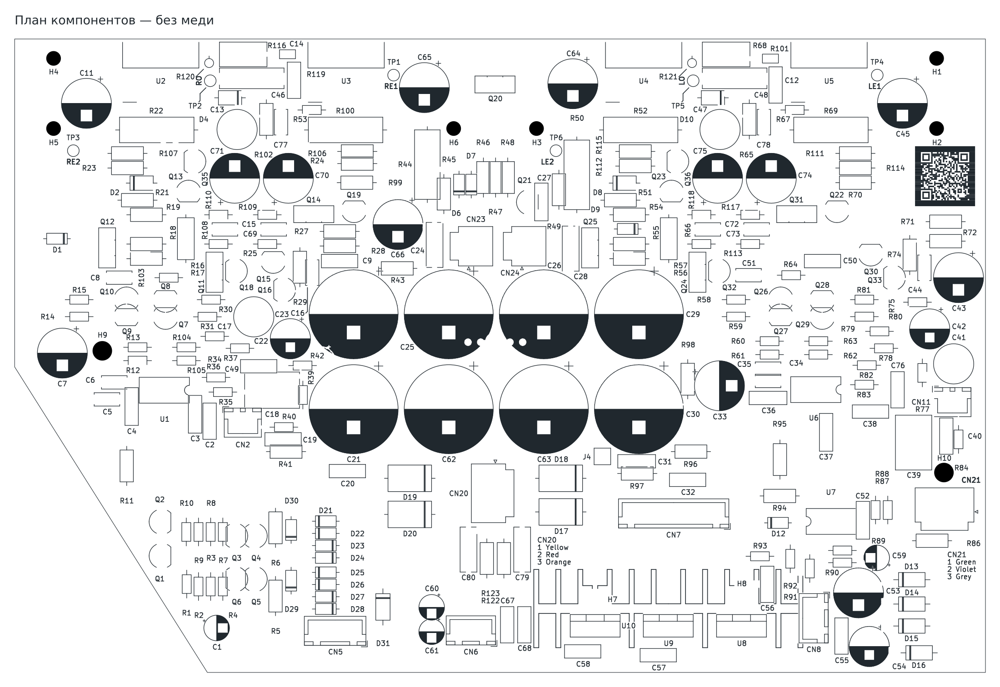
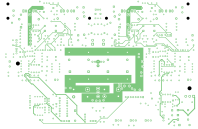
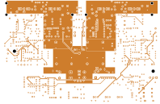

# Cambridge Audio Azur 640A — replacement main board

> **Board under testing.**

[Русский](README.md) · **English** · [Project website](https://SSSound13.github.io/Cambridge_640A_PowerAmp/en/)

Current revision for the **Cambridge 640A V1**, based on factory schematic AP12707/6 and PCB AP12708/6a. The amplifier topology and Sanken SAP15 output modules are retained.

## Status

[Current DRC](doc/v2/routing-review/final-drc.json): zero copper violations, unconnected items and schematic mismatches. Existing silkscreen and D2/R107 courtyard findings remain. [Routing review](doc/v2/ROUTING_TOPOLOGY_REVIEW.en.md). Fabrication files and assembly maps belong to the earlier revision.

## Project files

- [Parts list](BOM.en.md) · [Excel, Russian](BOM.xlsx) · [CSV, Russian](BOM.csv).
- [KiCad project ZIP](doc/v2/routing-review/Cambridge640A_routing_review.zip) · [KiCad project](640A_PowerAmp.kicad_pro). KiCad 10 or newer is required.
- [Fabrication ZIP — Gerber and drill files](production/Cambridge_640A_PowerAmp_production.zip) · [Fabrication specifications](production/README.en.md).
- [Four copper layers and routing principles](#all-four-copper-layers) · [Combined PDF](doc/v2/routing-review/routing-review.pdf).
- [Wiring](doc/v2/WIRING.en.md).
- [First power-up and bias adjustment](doc/v2/FIRST_POWER_UP_V2.en.md) · [Russian PDF](doc/v2/FIRST_POWER_UP_V2.pdf).
- [Factory service manual AP14676/1, English](doc/Cambridge_Azur_640A_V1_Service_Manual_AP14676-1.pdf).

## Assembly documents

- [Assembly guide, English](doc/assembly-notes/README.en.md).
- [Detailed assembly instructions, 13 steps — Russian PDF](doc/assembly-notes/640A_PowerAmp_v2_assembly_instructions.pdf).
- [Resistor value and power maps — Russian PDF](doc/assembly-notes/640A_PowerAmp_v2_resistors_by_value.pdf).
- [Assembly sequence, 13 stages — Russian PDF](doc/640A_PowerAmp_v2_assembly_order.pdf).
- [Component placement drawings — Russian PDF](doc/640A_PowerAmp_v2_assembly.pdf).
- [Harness assembly and board wiring — Russian PDF](doc/640A_PowerAmp_v2_wiring.pdf).
- [Current connector pin map — PDF](doc/assembly-notes/640A_power_connector_wire_colors.pdf) · [PNG](doc/assembly-notes/640A_power_connector_wire_colors.png).

The assembly maps and instructions below belong to the earlier revision; the current board is available in the KiCad ZIP above.

## Component placement

View from the component side, with the SAP15 output modules at the top. Reference designators correspond to the [BOM](BOM.en.md). This earlier-revision drawing shows component outlines and references without tracks or copper zones; use the KiCad project for the current placement.

[Vector drawing](doc/v2/layer-plans/components.svg) · [PDF](doc/v2/layer-plans/components.pdf)

## All four copper layers

Routing views show copper, pads, holes and the board outline without component outlines or references. Open each image to inspect the vector drawing. All four layers are viewed from the top, without mirroring.

### 1. Top layer — F.Cu

Local stage connections and some output and power connections. Component references are shown in the separate placement drawing.

Matching channel stages use matching local geometry. Signal and power tracks have different widths. Placement and routing are considered together: a short connection is useful when the return-current path also remains clear.

[PDF](doc/v2/routing-review/F_Cu.pdf)

### 2. First inner layer — In1.Cu

Primarily **+45 V and −45 V** power distribution through copper zones, with some individual tracks. This is not an uninterrupted power plane.

Power is fed through wide copper sections while maintaining zone connectivity. Each rail connects four reservoir capacitors to its two rectifier diodes on In1.Cu. Outer tracks carry the supply to the channels.

Compared with the original single-sided board, part of the power distribution moves from tracks and wires to inner copper. This gives more control over current paths and shared narrow sections. A numerical reduction in resistance or voltage drop has not been measured for this revision.

[PDF](doc/v2/routing-review/In1_Cu.pdf)

### 3. Second inner layer — In2.Cu

Primarily **PGND**, carrying rectifier, reservoir capacitor, output-stage and loudspeaker return currents. The main PGND connects all eight reservoir capacitors to CN20.3. The C79/C80 region connects to the main ground via F.Cu. Individual tracks and the cutouts around them remain visible.

Power currents should not return through incidental sections of signal ground. **PGND, GND, digital and AUX0V** are separated by function and meet through **NT1–NT3** near the capacitor-bank common point.

The original amplifier also organizes ground returns through wires. This design implements the arrangement in board geometry, improving reproducibility and reducing dependence on individual wire routing. Hum and channel interaction have not yet been compared by measurement.

[PDF](doc/v2/routing-review/In2_Cu.pdf)

### 4. Bottom layer — B.Cu

**Viewed from the top, like the other layer drawings.** A substantial part of the signal, output and auxiliary interconnections is routed here. Wire colours are also marked on the physical bottom silkscreen at the connectors.

The bottom copper works with the other layers to avoid long detours. Layer changes use the existing plated component holes. **There are no separate vias** in the current PCB. This describes the replacement board; it does not establish an advantage over the original single-sided board by itself.

[PDF](doc/v2/routing-review/B_Cu.pdf)

[All layers in one PDF](doc/v2/routing-review/routing-review.pdf) · [Annotated routing plans, Russian PDF](doc/v2/routing-review/topology-review.pdf)

## Routing rules

- **Corresponding channel stages use matching routes.** All 21 whole-net pairs retain exactly matching geometry, layers and widths after translation. Shared supplies, protection and external connections have their own geometry. [All-layer topology review](doc/v2/ROUTING_TOPOLOGY_REVIEW.en.md).
- **Width follows current and copper layer.** Selected widths: 0.5 / 0.8 / 1 / 2 / 3.5 mm. Output current paths use 2 mm on 70 µm outer copper. Measurement branches to TP use 0.5 mm. Main-secondary tracks use 3.5 mm outer copper. One channel at 100 W / 4 Ω draws 5 A RMS and 7.07 A peak. [Current calculations, width rationale and limitations](doc/v2/ROUTING_CURRENT_REVIEW.en.md).
- **Short paths with few bends.** Important areas were reviewed and revised manually after autorouting. New segments use straight directions and 45° corners; avoiding vias should not require excessive detours.
- **Check the complete current path.** Include the outgoing connection, return, zone connectivity, pad necks and ground meeting point.
- **Check all four layers together.** The current PCB has zero copper violations, unconnected items or schematic mismatches. Existing silkscreen findings and the D2/R107 courtyard overlap remain; full DRC is not clean. File checks do not replace prototype testing.

## Construction and servicing

**Fewer manual links.** The original main-board BOM lists 19 LK jumpers, plus WIRE LINK connections. These connections are implemented in copper, reducing jumper soldering and dependence on manual wire placement.

**Easier board removal.** JST VH connectors replace soldered transformer and output wires: CN20/CN21 for the secondary windings, CN23/CN24 for outputs. Pin numbers and wire colours are marked on the board.

**Inner-layer power and returns.** Four layers replace a single working copper side with wires and links. Power and PGND zones define their geometry in the project, with the aim of reducing the interaction of high currents and signal circuits.

**Repeatable local channel geometry.** Common placement rules and matching routes make the channels easier to compare during adjustment and repair. No measured improvement in channel separation is claimed.

**More convenient bias measurements.** TP1–TP6 provide attachment points for measuring voltage drops across the emitter resistors. They do not change amplifier operation.

**Larger electrolytic footprints.** C13/C47 and C22/C42: **Ø8 mm, 3.5 mm pitch**. C70/C71/C74/C75: **Ø10 mm, 5 mm pitch**. C13/C47 remain non-polar.

**Construction tradeoffs.** A four-layer board costs more than a single-sided board; inner copper is harder to inspect and repair. Connectors add contact interfaces. The lack of separate vias does not remove the need for reliable component-hole plating.

## Changes from the factory board and their purpose

The project retains the Cambridge 640A V1, its SAP15 modules and basic circuit topology while replacing the main board and improving assembly and service access. Power paths, return paths, interconnections and footprints have been revised. Electrical results require bench validation.

| Area | Factory AP12708/6a board | Current revision | Purpose |
|---|---|---|---|
| PCB | One copper layer and wire connections | Four layers; design copper 70 µm outside, 35 µm inside; 1.6 mm board | Separate signal, power and return paths with fewer shared sections |
| Jumpers | 19 LK jumpers and WIRE LINK connections | Copper connections; layer changes through plated component holes | Reduce manual connections and soldering |
| Output-stage supply | External tracks and wires | ±45 V zones on In1.Cu, widths chosen by function | Reduce power-path resistance and interaction with small-signal circuits |
| Ground | Tracks and wires to a common point | PGND, GND, digital and AUX0V meet at NT1–NT3; most of In2.Cu is PGND | Control return currents and shared impedance |
| Channel routing | Factory placement | Matching local routes for corresponding stages | Improve reproducibility and simplify comparison during adjustment |
| Transformer and output wiring | Wires soldered to terminals | JST VH CN20/CN21 and CN23/CN24, with pin and colour markings | Remove the board without desoldering these wires |
| Main bridge D17–D20 | 1N5402, 3 A | BY550-400, 5 A | Increase nominal diode current margin; verify temperature in hardware |
| Secondary RC snubbers | None | R122/R123: 47 Ω; C79/C80: 100 nF | Suppress high-frequency ringing; 47 Ω is the starting value for measurement-based adjustment |
| R41/R43/R96/R98 | 150 Ω, 0.25 W | 150 Ω, 0.5 W, fusible flameproof parts per BOM | Increase dissipation margin in the input-stage supplies |
| Bias adjustment | 47 Ω R116/R68 trimmers | Parallel 100 Ω R120/R121 added | Limit adjustment resistance: 47 Ω ∥ 100 Ω ≈ 32 Ω with a working trimmer. An open trimmer branch leaves 100 Ω; this does not guarantee safe fault current |
| Bias measurements | Directly across 0.22 Ω resistors | TP1–TP6 | Attach probes conveniently and check both halves of each channel |
| Input C18/C39 | 10 µF non-polar electrolytic | 2.2 µF / 100 V WIMA MKS2 film | Remove the input electrolytic; verify frequency response after reducing capacitance |
| Feedback C17/C41 | 100 µF NP | 220 µF NP | Lower this RC pole from about 1.6 to 0.7 Hz at 1 kΩ; this is not the complete amplifier's lower cutoff |
| Zobel C24/C28 | 100 nF | 100 nF / 250 V MKT; R44/R50 remain 4.7 Ω / 3 W | Selected film parts with voltage margin, retaining the network's function |
| Electrolytic footprints | Compact factory bodies | C13/C47, C22/C42: Ø8/P3.5; C70/C71/C74/C75: Ø10/P5 | Fit larger available parts; C13/C47 remain non-polar |
| +5 V and regulators | Linear 7805/7815/7915 | U8=7805, U9=7815, U10=7915 retained, with insulation kits | Retain linear regulation. The TRACO experiment was cancelled and C81 removed |
| Output modules and protection | SAP15N/SAP15P and original protection circuits | Basic circuit topology retained | Preserve amplifier structure and service-manual usability |

Inner layers also contain individual tracks and cutouts. Current geometry differs from the first manufactured batch; updating the files does not change an already assembled board.

## Calculated coupling comparison

**These numbers are not measurements.** The table preserves the engineering rationale for separated grounds and the star connection. It must not be presented as verified performance of the current revision.

Values are **mV per 1 A of disturbing current**; paired numbers are left / right channel.

| Disturbance | Factory board, calculated L / R | Earlier replacement routing, calculated L / R | Change in the model |
|---|---|---|---|
| Half-wave current → input reference | 0.045 / 0.040 | 0 / 0 | Shared resistive segment eliminated in the model |
| Charging current → input reference | 0.050 / 0.034 | 0 / 0 | Shared resistive segment eliminated in the model |
| Output-stage decoupling current → input reference | 0.023 / 0.031 | 0 / 0 | Shared resistive segment eliminated in the model |
| C66/C7 (C43/C33) filter current → input reference | 11.5 / 21.8 | 0.15 / 0.15 | Approximately 77 / 145 times lower |
| ±15 V decoupling current → input reference | 6.9 / 18.7–19.6 | 0.15 / 0.15 | Approximately 46 / 125–131 times lower |
| Filter current → current-source and cascode references | Up to 20 / up to 12.3 | 0 / 0 | Shared resistive segment eliminated in the model |
| Loudspeaker-return coupling L↔R | 0.008 | 0.0002 | 40 times lower |

Zero means no corresponding voltage drop in this resistive model. It does not imply no real interference or inductive/capacitive coupling. Ratios describe this coupling mechanism, not sound quality, THD, signal-to-noise ratio or complete-amplifier channel separation.

An earlier calculation also gave **1.55 mΩ for the replacement-board loudspeaker return**. The original was recorded as “0.05 (then wire)”, without an unambiguous unit in that row. These figures do not provide a comparable total path including external wire, so no improvement ratio is stated.

The next step is to repeat the calculation for the current copper and compare it with measurements of hum, channel interaction, stability and temperature.

## Sources and files

- [Factory service manual AP14676/1](doc/Cambridge_Azur_640A_V1_Service_Manual_AP14676-1.pdf): schematic, main-board assembly drawing and BOM; the 19 LK jumpers are listed on printed page 25.
- [Current PCB](640A_PowerAmp.kicad_pcb), [schematic](640A_PowerAmp.kicad_sch), [BOM](BOM.en.md).
- [Board geometry and test-point verification](doc/v2/validation/current_board.json).
- [Layer-export provenance](doc/v2/layer-plans/source.json) and [assembly-map provenance](doc/assembly-notes/source.json).
- [Fabrication package, specifications and checksums](production/README.en.md).
