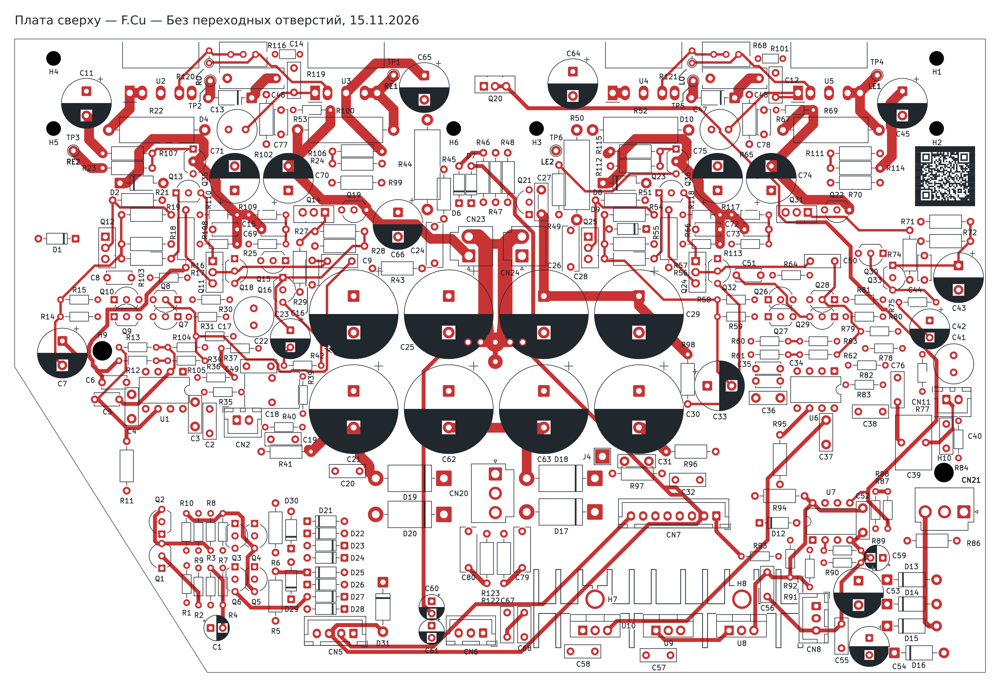

# Cambridge Audio Azur 640A — новая основная плата

Последняя ревизия проекта для **Cambridge 640A V1**, на основе заводской схемы AP12707/6 и PCB AP12708/6a. Сохранены топология усилителя и выходные модули Sanken SAP15.

## Файлы проекта

- [Перечень деталей — одна таблица BOM](BOM.md) · [скачать Excel](https://github.com/SSSound13/Cambridge_640A_PowerAmp/raw/refs/heads/main/BOM.xlsx).
- [Проект KiCad ZIP](doc/v2/no-vias/Cambridge_640A_no_vias.zip) · [открыть KiCad-проект](640A_PowerAmp.kicad_pro). Нужен KiCad 10 или новее.
- [Четыре слоя и принципы разводки](doc/v2/LAYER_GUIDE.md) · [все слои PDF](doc/v2/layer-plans/all_four_layers.pdf).
- [Подключение проводов](doc/v2/WIRING.md).
- [Первое включение и настройка](doc/v2/FIRST_POWER_UP_V2.md) · [PDF](doc/v2/FIRST_POWER_UP_V2.pdf).
- [Статус проверок](doc/v2/PROJECT_STATUS.md).
- [Заводской сервис-мануал AP14676/1](doc/Cambridge_Azur_640A_V1_Service_Manual_AP14676-1.pdf).

## Что реализовано

Четыре слоя: наружные для соединений, внутренние — для полигонов ±45 В и PGND с отдельными дорожками. Земли PGND/GND/digital/AUX0V соединены в звезде NT1–NT3. Межслойные соединения выполнены через металлизированные площадки деталей; отдельных переходных отверстий нет.

У согласованных узлов каналов одинаковые локальные маршруты. Ширины дорожек выбраны по назначению цепей. Выводы трансформатора и акустики подключаются через JST VH; рядом с разъёмами подписаны цвета проводов. TP1–TP6 предназначены для настройки тока покоя.

Посадки электролитов увеличены: **C13/C47 и C22/C42 — Ø8/P3,5; C70/C71/C74/C75 — Ø10/P5**. C13/C47 неполярные.

В питании предусмотрены RC-снабберы. R120/R121 ограничивают сопротивление цепей регулировки тока покоя. Подбор деталей и монтажные требования указаны в BOM.

## Статус

Исходники, BOM, чертежи и архив описывают одну текущую ревизию. Измерения шума, искажений, устойчивости и нагрева собранного усилителя пока не завершены; улучшение звука не заявляется без испытаний. Производственные Gerber в этот комплект не включены.

Сравнение с заводской платой и назначение решений приведены в [обзоре разводки](doc/v2/LAYER_GUIDE.md). Совместимость с Cambridge 640A второго поколения не заявляется.
