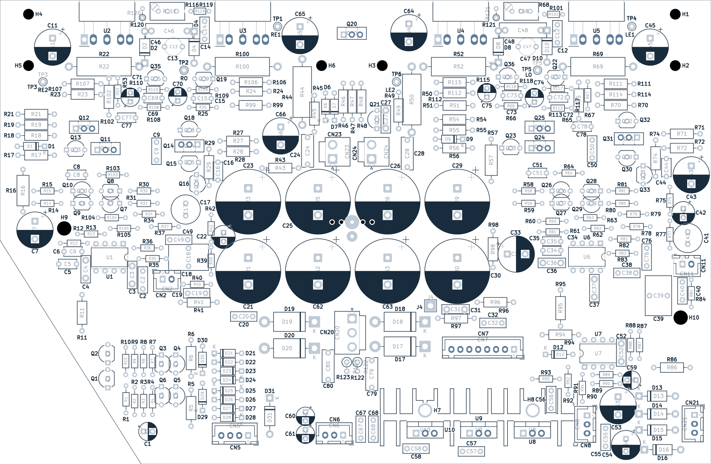

# Новая плата для любимого Cambridge 640A

Cambridge Audio Azur 640A хочется сохранить в работе. Этот проект посвящён восстановлению усилителя на новой четырёхслойной плате: с привычной схемотехникой, выходными модулями Sanken SAP15 и более удобным обслуживанием.

Плата разработана для **640A первой версии (V1)** на основе заводского узла AP12707/6 и PCB AP12708/6a. Можно использовать пригодные детали исходного усилителя, а схему, разводку и каждое изменение изучить в KiCad.

**v2 сейчас проходит проверку. После неё информация будет обновлена.**

*Монтажный вид из KiCad, не фотография собранной платы. [Рассмотреть в деталях](doc/v2/preview/front-assembly.png).*

## Что даёт новая плата

### Сохранить знакомый усилитель

В основе остаётся схема Cambridge, включая выходные SAP15. Контур и крепёж взяты за основу из оригинальной конструкции, чтобы проект подходил для восстановления имеющегося аппарата. Перенос исправных компонентов позволяет сохранить значительную часть усилителя. При этом SAP15 сняты с производства, а фактическую посадку деталей и радиатора ещё нужно проверить.

### Меньше проводов, проще обслуживание

Соединения, которые раньше выполнялись перемычками и проводами, перенесены в медь четырёхслойной платы. Трансформатор и акустика подключаются через разъёмы JST: для снятия платы эти провода больше не нужно отпаивать. Отдельные контрольные точки облегчают подключение щупов при настройке тока покоя, а крупные подписи помогают ориентироваться при сборке.

### Свой путь для силовых и сигнальных токов

Выходной каскад потребляет большие токи, а вход работает с малым сигналом. Если они используют общие участки земли, падение напряжения на этих участках может влиять на сигнал.

В новой разводке силовая, сигнальная, цифровая и вспомогательная земли разделены и сведены к звезде. Внутренние слои используются для питания и силовой земли. Цель: уменьшить взаимное влияние цепей и сделать пути токов понятными. Реальный результат по шуму и устойчивости предстоит измерить.

### Изменения с понятной причиной

В питании входных каскадов применены огнестойкие резисторы большей мощности, в основном выпрямителе выбраны диоды с большим запасом по току. Добавлены резисторы, ограничивающие рост сопротивления цепи регулировки тока покоя, и RC-снабберы для подавления звона вторичной обмотки.

На входе используются плёночные конденсаторы, увеличена ёмкость конденсаторов обратной связи. У каждой замены есть конкретная задача. Итоговую АЧХ, нагрев и поведение при неисправностях ещё нужно проверить; обещаний улучшенного звука без измерений здесь нет.

### Исходники, которые можно изучить и доработать

Схема, плата, специальные библиотеки и перечень компонентов доступны в репозитории. Можно проследить соединения, подобрать детали и понять причины изменений. В BOM указаны партномера и замечания по монтажу, рядом сохранены изображения и результаты проверок. Проект полезен и для собственного ремонта, и для обсуждения решений с другими разработчиками.

## Сравнение с оригиналом

Что меняется при переходе с заводской платы на новую. Номиналы и конструкция относятся к **актуальным исходникам v2**, а не старому производственному архиву. Три строки с отметкой ¹ содержат прежние расчётные оценки, ещё не перепроверенные для текущей v2. Результаты работы собранного усилителя предстоит измерить.

| Параметр | Оригинал AP12708/6a | Новая плата v2 |
|---|---|---|
| Слои меди | Один снизу, соединения сверху перемычками | Четыре; в проекте 70 мкм снаружи и 35 мкм внутри, номинальная толщина платы 1,6 мм |
| Перемычки | 19 LK по схеме и 5 проволочных WIRE LINK | Соединения выполнены медью платы; впаивать перемычки не нужно |
| Провода трансформатора и акустики | Впаяны в клеммы | Разъёмы JST VH 3,96 мм для силовых цепей и XH 2,5 мм для вспомогательной обмотки; J4 для корпуса сохранена |
| Питание ±45 В выходных каскадов | Дорожки и отрезки провода | Полигоны In1.Cu, шины батареи конденсаторов шириной 3,4 мм |
| Силовая земля | Дорожки и провода WIRE1–4 к звезде | Полигон PGND на отдельном внутреннем слое In2.Cu |
| Разделение земель | Провода и общие участки дорожек | PGND / GND / digital / AUX0V, соединение в звезде NT1–NT3 |
| Влияние токов фильтров на опору входа, мВ/А (L / R)¹ | 11,5 / 21,8 | 0,15 / 0,15 |
| Влияние тока заряда и выпрямителя на опору входа, мВ/А¹ | 0,03–0,05 | 0 в прежней модели |
| Перекрёстная связь возвратов АС L↔R, мВ/А¹ | 0,008 | 0,0002 |
| Мост основного питания D17–D20 | 1N5402, 3 А | Diotec BY550-400, 5 А / 400 В, по текущему BOM |
| Снабберы вторичной обмотки | Нет | 47 Ом + 100 нФ на каждую половину; сопротивление подбирается по измеренному звону |
| Регулировка тока покоя R116 / R68 | Реостат 47 Ом | Добавлены параллельные 100 Ом R120 / R121; исправная цепь до ≈32 Ом² |
| Контроль тока покоя | Щупы на выводах резисторов 0,22 Ом | Отдельные контрольные точки TP1–TP6 |
| R41, R43, R96, R98 | 150 Ом / 0,25 Вт | 150 Ом / 0,5 Вт, огнестойкие |
| Входной конденсатор C18 / C39 | 10 мкФ, неполярный электролит | 2,2 мкФ, плёнка WIMA MKS2 |
| Конденсатор обратной связи C17 / C41 | 100 мкФ NP; расчётный полюс RC ≈1,6 Гц³ | 220 мкФ NP; расчётный полюс RC ≈0,7 Гц³ |
| Цепь Цобеля C24 / C28 | 100 нФ и 4,7 Ом / 3 Вт | 100 нФ / 250 В MKT; резисторы 4,7 Ом / 3 Вт остаются проволочными |
| +5 В для PIC | 7805 на общем радиаторе с 7815 / 7915 | Возвращён штатный 7805 на общем радиаторе, стандартный KiCad TO-220; TRACO не используется, C81 удалён |
| Электрическая связь радиатора стабилизаторов | Через фланец 7805 | Через фланец U8 (digital); отдельная дорожка H8 удалена. U9 и U10 устанавливаются с изоляторами |
| Выходные модули | Sanken SAP15N / SAP15P | Те же типы модулей, монтаж на радиаторе; фактическая посадка проверяется при сборке |
| Топология усилителя и защиты | Схемотехника Cambridge 640A V1 | Базовая схема сохранена; доработаны вспомогательные цепи, компоненты и разводка |

¹ **Исторические расчётные оценки, не результаты измерений.** Эти три строки восстановлены из [прежнего сравнения и расчёта сопротивлений земли от 25.09.2026](https://github.com/SSSound13/Cambridge_640A_PowerAmp/blob/8188b4cc4bade1c1e03b41d10146da4cc2be14a8/README.md). Расчёт не повторён для текущей исправленной v2. Ноль в резистивной модели не означает отсутствия реальных помех, а эти числа не являются измерением шума или разделения каналов усилителя.

² 47 Ом ∥ 100 Ом ≈ 32 Ом по номиналам компонентов. Это не гарантия безопасного тока покоя при любой неисправности; поведение требует проверки.

³ Оценка отдельной RC-цепи при 1 кОм: 1 / (2πRC). Это не измеренная нижняя граница АЧХ всего усилителя.

Полные типы деталей и монтажные ограничения: [BOM](BOM.md). Текущие исправления и проверки: [описание v2](doc/v2/MINIMAL_FIXES.md) и [результаты проверок](doc/v2/VALIDATION.md).

## Версия 2: что уже сделано и что дальше

После первой изготовленной партии подготовлены минимальные исправления v2:

- Устранено ошибочное соединение входа U6 с +15 V.
- Возвращён стабилизатор 7805, убраны C81 и отдельная дорожка H8 для установки целого радиатора.
- Укрупнены и упорядочены подписи, добавлены обозначения контрольных точек, контур радиатора и ссылка на проект с обратной стороны.

Остальные компоненты сохранены на своих местах. Проверки файлов выполнены, но работа собранной платы, защита, механика и тепловой режим ещё не подтверждены. **Это проверочная версия, не готовый производственный релиз.** Подробности: [исправления и монтаж](doc/v2/MINIMAL_FIXES.md), [результаты и границы проверок](doc/v2/VALIDATION.md).

**Важно для заказа:** `gerber/` и ZIP от 03.10.2026 являются историческим архивом первой партии. Они содержат ошибочную связь U6 с +15 V и **не должны использоваться для нового заказа**. Исправленного производственного комплекта пока нет. Обновление исходников не исправляет уже изготовленную плату.

В [отдельном плане v3](https://github.com/SSSound13/Cambridge_640A_PowerAmp/blob/v3/TODO.md) находятся симметричная компоновка каналов и дальнейшее улучшение размещения компонентов. Это отдельная будущая ревизия, не готовый выпуск.

## С чего начать

- **Посмотреть плату:** [монтажный вид и шелкография](doc/v2/preview/).
- **Разобраться с деталями:** [BOM и замечания по сборке](BOM.md).
- **Открыть исходники:** [проект KiCad](640A_PowerAmp.kicad_pro), нужен KiCad 10.0 или новее.
- **Проверить текущий статус:** [исправления v2](doc/v2/MINIMAL_FIXES.md) и [проверки](doc/v2/VALIDATION.md). Старые отчёты и сборочные PDF оставлены для истории.

Здесь **V1 означает поколение усилителя**, а **v2 означает версию новой платы**. Совместимость с Cambridge 640A V2 не заявляется.
