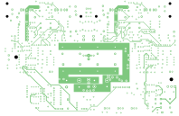

# Cambridge Audio Azur 640A — новая основная плата

> **Плата тестируется.**

**Русский** · [English](README.en.md) · [Сайт проекта](https://SSSound13.github.io/Cambridge_640A_PowerAmp/)

Последняя ревизия проекта для **Cambridge 640A V1**, на основе заводской схемы AP12707/6 и PCB AP12708/6a. Сохранены топология усилителя и выходные модули Sanken SAP15.

## Статус

[Текущий DRC](doc/v2/routing-review/final-drc.json): нет нарушений по меди, несоединений и расхождений со схемой. Сохраняются замечания к шелкографии и монтажным контурам D2/R107. [Проверка разводки](doc/v2/ROUTING_TOPOLOGY_REVIEW.md). Файлы производства и монтажные карты относятся к предыдущей ревизии.

## Файлы проекта

- [Перечень деталей — одна таблица BOM](BOM.md) · [скачать Excel](https://github.com/SSSound13/Cambridge_640A_PowerAmp/raw/refs/heads/main/BOM.xlsx).
- [Проект KiCad ZIP](doc/v2/routing-review/Cambridge640A_routing_review.zip) · [открыть KiCad-проект](640A_PowerAmp.kicad_pro). Нужен KiCad 10 или новее.
- [Gerber и сверловка — ZIP для производства](production/Cambridge_640A_PowerAmp_production.zip) · [Параметры изготовления](production/README.md).
- [Четыре слоя и принципы разводки](#все-четыре-слоя-платы) · [все слои PDF](doc/v2/routing-review/routing-review.pdf).
- [Подключение проводов](doc/v2/WIRING.md).
- [Первое включение и настройка](doc/v2/FIRST_POWER_UP_V2.md) · [PDF](doc/v2/FIRST_POWER_UP_V2.pdf).
- [Заводской сервис-мануал AP14676/1](doc/Cambridge_Azur_640A_V1_Service_Manual_AP14676-1.pdf).

## Документы по сборке

- [Пошаговая инструкция ручного монтажа, 13 шагов — PDF](doc/assembly-notes/640A_PowerAmp_v2_assembly_instructions.pdf).
- [Резисторы по номиналам и мощности, карты установки — PDF](doc/assembly-notes/640A_PowerAmp_v2_resistors_by_value.pdf).
- [Порядок сборки, 13 этапов — PDF](doc/640A_PowerAmp_v2_assembly_order.pdf).
- [Монтажные планы и таблица изменений v2 — PDF](doc/640A_PowerAmp_v2_assembly.pdf).
- [Сборка жгутов и подключение платы — PDF](doc/640A_PowerAmp_v2_wiring.pdf).
- [Контакты и цвета проводов текущей платы — PDF](doc/assembly-notes/640A_power_connector_wire_colors.pdf) · [PNG](doc/assembly-notes/640A_power_connector_wire_colors.png).
- [Документы по сборке и их исходные данные](doc/assembly-notes/README.md), [подключение текущей ревизии](doc/v2/WIRING.md), [первое включение и настройка](doc/v2/FIRST_POWER_UP_V2.md) · [PDF](doc/v2/FIRST_POWER_UP_V2.pdf).

Монтажные карты и инструкции ниже относятся к предыдущей ревизии; актуальная плата доступна в KiCad ZIP выше.

## План размещения компонентов

Вид со стороны компонентов, выходные SAP15 — сверху. Позиционные обозначения позволяют найти детали по [BOM](BOM.md). На монтажном виде показаны только контуры и обозначения компонентов, без медных дорожек и полигонов. Это план предыдущей ревизии; актуальное размещение — в KiCad-проекте.

[Открыть векторный план](doc/v2/layer-plans/components.svg) · [Скачать PDF](doc/v2/layer-plans/components.pdf)

## Все четыре слоя платы

На видах разводки показаны только медь, контактные площадки, отверстия и контур платы — без контуров и обозначений компонентов. Каждое изображение можно открыть отдельно в векторном формате. Все четыре слоя показаны сверху, без зеркального отражения.

### 1. Верхний слой — F.Cu

Вид со стороны деталей. Здесь проходят локальные соединения каскадов, часть выходных и силовых цепей. Обозначения деталей вынесены на отдельный план компонентов выше.

Принцип: у одинаковых узлов каналов сохранять одинаковую геометрию, не делать длинных обходов ради удобства автоматического трассировщика. Сигнальные дорожки и силовые соединения имеют разную ширину. Расстановка и трассировка рассматриваются вместе: короткое соединение полезнее, если при этом остаётся понятным путь обратного тока.

[PDF](doc/v2/routing-review/F_Cu.pdf)

### 2. Первый внутренний слой — In1.Cu

Основная задача — распределение **+45 В и −45 В** полигонами. На этом же слое проходят отдельные соединительные дорожки; это не сплошной слой питания без разрывов.

Принцип: подводить питание широкими участками меди и сохранять электрическую связность всех частей заливки. На In1.Cu каждая шина соединяет четыре накопительных конденсатора с двумя диодами выпрямителя. От шин к каналам питание идёт по наружным дорожкам.

По сравнению с заводской односторонней разводкой часть питания перенесена с дорожек и проводов на внутреннюю медь. Это даёт больше свободы для распределения токов и уменьшения общих узких участков. Численного выигрыша по сопротивлению и падению напряжения относительно оригинала для этой версии не измеряли.

[PDF](doc/v2/routing-review/In1_Cu.pdf)

### 3. Второй внутренний слой — In2.Cu

Основная задача — **силовая земля PGND**: возвраты выпрямителя, накопительных конденсаторов, выходных каскадов и акустики. Основная область PGND соединяет все восемь накопительных конденсаторов с CN20.3. Область C79/C80 связана с основной землёй дорожкой на F.Cu. Отдельные дорожки присутствуют и на этом слое; вырезы вокруг них видны на плане.

Принцип: силовые токи не должны использовать случайные участки сигнальной земли как свой возврат. Цепи **PGND, GND, digital и AUX0V** разделены по назначению и соединены через **NT1–NT3** возле общей точки банка конденсаторов.

Звезда земли не является новым изобретением этого проекта: в оригинале также есть организация возвратов проводами. Здесь её реализация перенесена в геометрию платы. Это делает соединения воспроизводимыми и уменьшает зависимость от прокладки отдельных проводов. Снижение фона и взаимного влияния каналов пока не подтверждено измерениями.

[PDF](doc/v2/routing-review/In2_Cu.pdf)

### 4. Нижний слой — B.Cu

**Вид сверху, как и для остальных слоёв.** Здесь находится значительная часть межкомпонентных соединений, в том числе сигнальные, выходные и вспомогательные цепи. Нижняя шелкография содержит обозначения цветов проводов у разъёмов.

Принцип: использовать нижнюю медь совместно с остальными слоями, чтобы обходы не превращались в длинные «лестницы». Переключение между слоями выполняется через существующие металлизированные площадки выводных деталей. **Отдельных переходных отверстий в текущем проекте нет.** Это свойство новой платы, а не доказательство преимущества перед заводской односторонней платой.

[PDF](doc/v2/routing-review/B_Cu.pdf)

[Все четыре слоя одним PDF](doc/v2/routing-review/routing-review.pdf) · [Планы с комментариями, PDF](doc/v2/routing-review/topology-review.pdf) · [Общие правила разводки](#общие-правила-разводки)

## Общие правила разводки

- **Соответствующие узлы каналов разводятся одинаково.** Для 21 пары целых цепей проверено точное совпадение формы, слоя и ширины после сдвига. Общие питания, защита и внешние подключения имеют собственную геометрию. [Проверка топологии всех четырёх слоёв](doc/v2/ROUTING_TOPOLOGY_REVIEW.md).
- **Ширина зависит от тока и слоя.** Приняты 0,5 / 0,8 / 1 / 2 / 3,5 мм. Для силовых путей выходов приняты 2 мм на внешней меди 70 мкм, для измерительных отводов TP — 0,5 мм. Основные трансформаторные дорожки имеют ширину 3,5 мм на внешних слоях. Для одного канала 100 Вт / 4 Ом расчёт даёт 5 А RMS и 7,07 А пикового тока. [Расчёт токов, обоснование ширин и ограничения](doc/v2/ROUTING_CURRENT_REVIEW.md).
- **Короткие пути без лишних изгибов.** Важные участки проверены и переработаны вручную после автоматической трассировки. У новых сегментов прямые направления и углы 45°; отсутствие переходов не должно достигаться ценой чрезмерного обхода.
- **Проверяется весь путь тока.** Учитываются не только прямая дорожка, но и возврат, связь полигонов, сужения у площадок и общая точка земель.
- **Четыре слоя проверяются вместе.** В текущем PCB нет нарушений по меди, несоединений или расхождений со схемой. Остались замечания к шелкографии и монтажным контурам D2/R107; полный DRC не чистый. Проверка файлов не заменяет испытание усилителя.

## Конструктивный результат и обслуживание

**Меньше ручных соединений.** В оригинале применены проволочные перемычки LK — в BOM основной платы указано 19 штук — и соединения WIRE LINK. В новой плате эти связи выполнены медью. Результат: меньше операций пайки перемычек и меньше зависимости от их ручной прокладки.

**Более удобное снятие платы.** В оригинале провода трансформатора и выходов припаяны к клеммам. В текущем проекте используются разъёмы JST VH: CN20/CN21 для вторичных обмоток, CN23/CN24 для выходов. На шелкографии указаны номера контактов и цвета проводов. Соединения можно разъединить без выпаивания проводов.

**Питание и возвраты перенесены на внутренние слои.** Вместо одной рабочей стороны меди с проводами и перемычками используются четыре слоя. Полигоны питания и PGND позволяют задать их геометрию в проекте. Назначение — уменьшить влияние больших токов на сигнальные цепи; результат по шуму пока предстоит проверить.

**Повторяемость каналов.** Для соответствующих узлов заданы общие правила размещения и одинаковые локальные маршруты. Это упрощает сравнение каналов при проверке и ремонте. Улучшение разделения каналов в децибелах не заявляется без измерений.

**Удобнее настройка.** Добавлены TP1–TP6 для измерений падения на эмиттерных резисторах. В заводском порядке измерения выполняются непосредственно на резисторах. Назначение контрольных точек — удобное подключение прибора; они сами по себе не изменяют работу усилителя.

**Расширены посадочные места электролитов:** C13/C47 и C22/C42 — **Ø8 мм, шаг 3,5 мм**; C70/C71/C74/C75 — **Ø10 мм, шаг 5 мм**. C13/C47 остаются неполярными. Это запас под более крупные корпуса выбранных деталей.

**Цена этих изменений:** четырёхслойная плата сложнее и дороже односторонней; внутреннюю медь нельзя осмотреть или исправить так же просто, как наружную. Разъёмы добавляют контактные соединения. Отсутствие отдельных переходов не отменяет требований к качеству металлизации отверстий компонентов.

## Источники и файлы

- [Сервис-мануал Cambridge Azur 640A V1 AP14676/1](doc/Cambridge_Azur_640A_V1_Service_Manual_AP14676-1.pdf): заводская схема, монтажный рисунок основной платы и BOM; список 19 LK — печатная стр. 25.
- [Текущая PCB](640A_PowerAmp.kicad_pcb), [схема](640A_PowerAmp.kicad_sch), [BOM](BOM.md).
- [Проверка текущей геометрии и измерительных точек](doc/v2/validation/current_board.json); [посадки и детали](BOM.md).
- [Контрольная сумма PCB и послойных файлов](doc/v2/layer-plans/source.json). Послойные PDF/SVG соответствуют текущей PCB; исходный экспорт выполнен KiCad 10.0.8. План компонентов и верхняя медь разделены на отдельные виды; их PDF и PNG подготовлены из SVG, происхождение указано в source.json. [Производственный комплект Gerber и сверловки](production/README.md).

## Что изменили относительно заводской платы и зачем

Проект позволяет сохранить Cambridge 640A V1 с его штатными выходными модулями SAP15 и базовой схемотехникой, обновив основную плату и сделав её удобнее для сборки и обслуживания. Переработаны пути питания и обратных токов, соединения и посадки деталей. Электрический результат этих решений предстоит подтвердить испытаниями.

| Узел | Заводская плата AP12708/6a | Текущая ревизия | Для чего изменено |
|---|---|---|---|
| Печатная плата | Один слой меди и проволочные соединения | Четыре слоя; по проекту 70 мкм меди снаружи, 35 мкм внутри; толщина 1,6 мм | Развести сигналы, питание и возвраты токов с меньшим количеством общих участков |
| Перемычки | 19 LK и соединения WIRE LINK | Соединения выполнены медью; межслойные переходы через металлизированные площадки компонентов | Уменьшить число ручных соединений и операций пайки |
| Питание выходных каскадов | Наружные дорожки и провода | Полигоны ±45 В на In1.Cu; ширины соединений выбраны по назначению | Снизить сопротивление силовых путей и их влияние на малосигнальные цепи |
| Земля | Возвраты дорожками и проводами к общей точке | PGND, GND, digital и AUX0V соединяются в звезде NT1–NT3; PGND занимает основную область In2.Cu | Управлять путями обратных токов, уменьшить общие сопротивления и взаимное влияние каналов |
| Разводка каналов | Заводская компоновка | У согласованных узлов одинаковые локальные маршруты | Сделать поведение каналов более повторяемым, упростить сравнение при наладке |
| Подключение трансформатора и выходов | Провода припаяны к клеммам | CN20/CN21 и CN23/CN24 — JST VH с маркировкой контактов и цветов проводов | Снимать плату без выпаивания этих проводов, облегчить сборку жгутов |
| D17–D20, основной мост | 1N5402, 3 А | BY550-400, 5 А, по BOM | Увеличить номинальный запас диодов по току; тепловой режим проверить на собранном аппарате |
| RC-снабберы вторичной обмотки | Отсутствуют | R122/R123 по 47 Ом и C79/C80 по 100 нФ | Подавлять высокочастотный звон; 47 Ом — начальный номинал, окончательный подбор по измерениям |
| R41/R43/R96/R98 | 150 Ом / 0,25 Вт | 150 Ом / 0,5 Вт, огнестойкое fusible-исполнение по BOM | Увеличить запас по рассеиваемой мощности в питании входных каскадов |
| Регулировка тока покоя | Подстроечники R116/R68 по 47 Ом | Добавлены параллельные резисторы R120/R121 по 100 Ом | Ограничить сопротивление регулируемой цепи; 47 Ом ∥ 100 Ом ≈ 32 Ом при исправном подстроечнике. При обрыве его ветви остаётся 100 Ом — это не гарантия безопасного тока при неисправности |
| Измерение тока покоя | На выводах резисторов 0,22 Ом | TP1–TP6 | Удобнее закреплять щупы и отдельно проверять оба плеча каждого канала |
| C18/C39, вход | 10 мкФ, неполярный электролит | 2,2 мкФ / 100 В, плёнка WIMA MKS2 | Убрать входной электролит; проверить итоговую АЧХ после уменьшения ёмкости |
| C17/C41, обратная связь | 100 мкФ NP | 220 мкФ NP | Снизить расчётную частоту полюса этой RC-цепи: при 1 кОм примерно с 1,6 до 0,7 Гц; это не нижняя граница АЧХ всего усилителя |
| C24/C28, цепи Цобеля | 100 нФ | 100 нФ / 250 В MKT; R44/R50 остаются 4,7 Ом / 3 Вт | Использовать выбранные плёночные компоненты с запасом по напряжению, сохранив назначение цепи |
| Посадки электролитов | Компактные заводские корпуса | C13/C47 и C22/C42 — Ø8 мм / шаг 3,5 мм; C70/C71/C74/C75 — Ø10 мм / шаг 5 мм | Разместить более крупные доступные компоненты; C13/C47 остаются неполярными |
| +5 В и стабилизаторы | Линейные 7805/7815/7915 | Сохранены U8=7805, U9=7815, U10=7915; текущий BOM предусматривает изоляционные комплекты | Сохранить штатный способ стабилизации. Эксперимент с TRACO отменён, C81 удалён; снижения нагрева от импульсного модуля в текущей версии нет |
| Выходные модули и защита | SAP15N/SAP15P, штатные цепи защиты | Базовая схемотехника сохранена | Сохранить устройство усилителя и возможность обслуживания по заводскому мануалу |

Внутренние слои также содержат отдельные дорожки и вырезы: это не сплошные идеальные плоскости. Геометрия текущей ревизии отличается от первой изготовленной партии; новые посадки и маршруты не появляются на уже собранной плате после обновления файлов.

## Таблица расчётных улучшений

**Числа не являются измерениями.** Таблица сохраняет инженерное обоснование разделения земель и звезды; её нельзя представлять как подтверждённые характеристики последней ревизии.

Все значения в основной таблице — **мВ на 1 А возмущающего тока**; пары чисел — левый / правый канал.

| Воздействие | Заводская плата, расчёт L / R | Прежняя новая разводка, расчёт L / R | Изменение в модели |
|---|---|---|---|
| Полуволновой ток → опора входа | 0,045 / 0,040 | 0 / 0 | Устранён общий резистивный участок в модели |
| Ток заряда → опора входа | 0,050 / 0,034 | 0 / 0 | Устранён общий резистивный участок в модели |
| Ток развязки выходных каскадов → опора входа | 0,023 / 0,031 | 0 / 0 | Устранён общий резистивный участок в модели |
| Ток фильтров C66/C7 (C43/C33) → опора входа | 11,5 / 21,8 | 0,15 / 0,15 | Примерно в 77 / 145 раз меньше |
| Ток развязки ±15 В → опора входа | 6,9 / 18,7–19,6 | 0,15 / 0,15 | Примерно в 46 / 125–131 раз меньше |
| Ток фильтров → опоры генератора стабильного тока и каскода | До 20 / до 12,3 | 0 / 0 | Устранён общий резистивный участок в модели |
| Перекрёстная связь возвратов АС L↔R | 0,008 | 0,0002 | В 40 раз меньше |

Ноль означает отсутствие соответствующего падения напряжения в этой резистивной модели. Он не означает отсутствия реальных помех, индуктивной и ёмкостной связи. Кратности в таблице относятся к указанному механизму связи, а не к улучшению звука, THD, отношению сигнал/шум или разделению каналов всего усилителя.

В прежнем расчёте также было **сопротивление возврата АС на новой плате 1,55 мОм**. Для оригинала записано «0,05 (далее провод)», без однозначного указания единицы в самой строке. Эти величины не дают сопоставимого результата для полного пути вместе с внешним проводом; строка сохранена здесь как историческое замечание, без объявления выигрыша.

Следующий этап — повторить расчёт для текущей меди и сопоставить его с измерениями фона, взаимного влияния каналов, устойчивости и нагрева. Подробности реализации: [четыре слоя и принципы разводки](#все-четыре-слоя-платы).
