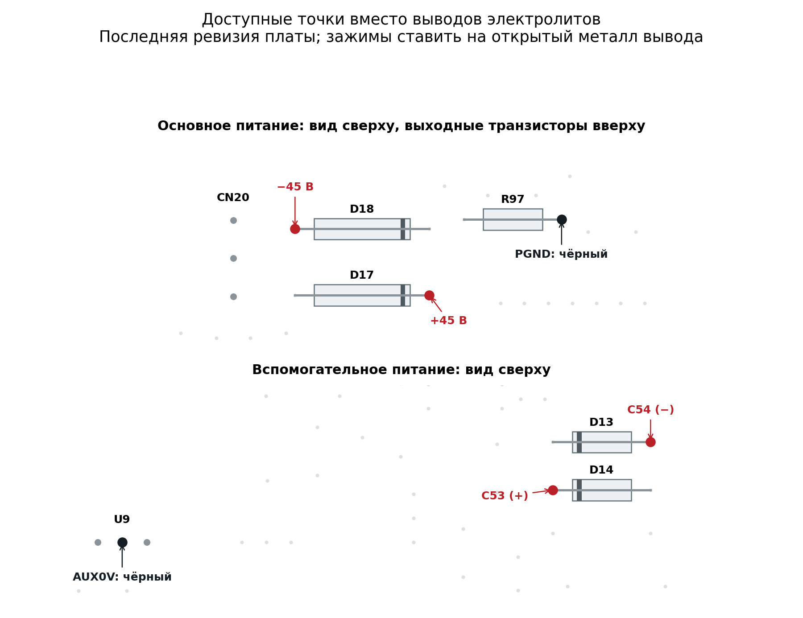

# First power-up and bias adjustment — Cambridge 640A, current revision

[Русский](FIRST_POWER_UP_V2.md) · [Project overview](../../README.en.md)

**Disconnect speakers and input signal. Set volume to minimum. Fit the heatsinks.**

**Before working:** unplug the amplifier. Set the meter to **DC V**. Check all four discharge measurements below: each must be **less than 1 V in magnitude**. If higher, wait; do not short anything.

| Supply to check | Red probe | Black probe |
|---|---|---|
| Main positive supply, C23 | **D17, banded end** | **R97, right-hand lead** |
| Main negative supply, C21 | **D18, unbanded end** | **R97, right-hand lead** |
| Auxiliary positive supply, C53 | **D14, banded end** | **U9, centre pin 2** |
| Auxiliary negative supply, C54 | **D13, unbanded end** | **U9, centre pin 2** |

“Switch off and check discharge” below means this complete procedure. Move probes only afterwards. Connect the black meter lead to COM and red to V/Ω; do not use the A/mA sockets.

**U9.3** means pin 3 of U9. For a standard TO-220 U8/U9/U10, looking at the marked face with leads pointing down, pins are **1–2–3 from left to right**. For DIP-8 U6 viewed from above with the notch at the top, the left side runs **1–2–3–4 downward**, and the right side **5–6–7–8 upward**. TP1–TP6 are the labelled PCB test pads.

## Probe attachment points

**Top view, output transistors at the top.** Contact the exposed metal lead between the component body and the PCB, not the body. Attach insulated mini-grabbers with power disconnected.

- **D17: right-hand lead, banded end — +45 V.**
- **D18: left-hand lead, unbanded end — −45 V.**
- **R97: right-hand lead, nearer the right board edge — PGND.** Use this as the black-probe reference for the main supplies and output DC.
- **D14: left-hand lead, banded end — C53 positive.**
- **D13: right-hand lead, unbanded end — C54 negative.**
- **U9: centre pin 2 — AUX0V.** Use this to check auxiliary-supply discharge.

There is no need to touch the capacitor terminals for these checks. **J4 and the left-hand R97 lead are not substitutes for the right-hand R97 lead:** a resistor separates them from PGND.

## 1. Before applying power

| Check | Expected result |
|---|---|
| U6.2 ↔ U9.3, resistance mode | No direct near-zero-ohm short |
| U6.7 ↔ U9.3, resistance mode | Direct connection, approximately 0 Ω |
| CN20 pins 1 / 2 / 3 | Yellow / red / **orange centre tap** |
| CN21 pins 1 / 2 / 3 | Green / **violet centre tap** / grey |
| C13/C47 | Non-polar 10 µF |
| C22/C42 | Installed, leads insulated |
| C16/C44 | Do not fit (DNP) |
| U8/U9/U10 | Insulating pads and mounting hardware, thermal compound |
| SAP15 | Installed on heatsinks with the intended insulation |
| Remaining assembly | Correct polarities; no shorts, wire offcuts or exposed splices |

**If a check fails, correct it before applying power.**

### Required: set R116 and R68 before first power-up

**Unplug the amplifier and confirm discharged capacitors. Set the meter to resistance.**

1. Put the probes on the **two leads of R120**, one at each end. Probe colour does not matter.
2. Turn **R116** while watching the resistance. Set the **minimum reading, close to 0 Ω**. Do not assume a clockwise direction; follow the decreasing reading.
3. Move the probes to the **two leads of R121**. Turn **R68** to the same near-zero minimum.
4. Remove the probes. **R116 and R68 are now in their starting positions. Do not turn them again until section 4.**

R120 is parallel to the adjusted section of R116; R121 is parallel to R68. This avoids guessing trimmer pin numbers. If resistance does not change or the minimum is not near 0 Ω, do not power up; check assembly.

## 2. First power-up through a lamp limiter

**R116/R68 were set to minimum resistance in section 1. Do not turn them now.**

1. With power disconnected, select **DC V**. Red probe: **D17, right-hand banded lead**. Black probe: **R97, right-hand lead**.
2. Power through an enclosed limiter using a **100–150 W, 230 V incandescent lamp**.
3. Expected behaviour: the lamp flashes then becomes substantially dimmer; D17 shows a positive voltage. Record it. Switch off and check discharge.
4. Check the other rows below. For every row: **attach probes without power → power through the lamp → measure → switch off and check discharge**.

| Measurement | Meter mode | Red probe | Black probe | Through-lamp check |
|---|---|---|---|---|
| Positive supply, already measured | DC V | D17 banded lead | R97 right-hand lead | Positive; nominal without lamp +45 V |
| Negative supply | DC V | D18 unbanded lead | R97 right-hand lead | Negative; nominal without lamp −45 V |
| +15 V | DC V | U9.3 | U9.2 | Positive, about +15 V* |
| −15 V | DC V | U10.3 | U10.1 | Negative, about −15 V* |
| +5 V | DC V | U8.3 | U8.2 | Positive, about +5 V* |
| Left output DC | DC V, then mV | TP2 | R97 right-hand lead | Less than 50 mV magnitude |
| Right output DC | DC V, then mV | TP5 | R97 right-hand lead | Less than 50 mV magnitude |
| R100 bias drop | DC mV | TP1 | TP2 | Less than 25 mV; no rapid spontaneous rise |
| R22 bias drop | DC mV | TP2 | TP3 | Less than 25 mV; no rapid spontaneous rise |
| R69 bias drop | DC mV | TP4 | TP5 | Less than 25 mV; no rapid spontaneous rise |
| R52 bias drop | DC mV | TP5 | TP6 | Less than 25 mV; no rapid spontaneous rise |

*The lamp can reduce supply voltages. There is no single exact tolerance for this mode. Investigate substantially low regulator outputs before removing the lamp.*

**Switch off immediately** if the lamp stays bright, there is smoke, smell or rapid heating, output DC reaches ≥0.5 V, or any bias drop reaches ≥25 mV or rises rapidly by itself. Compare bias-drop magnitude regardless of sign.

After the table passes without deviations, **switch off, check discharge and remove the lamp**. Do not set operating bias through the lamp. The lamp does not provide mains isolation.

## 3. Power without the lamp: measure and compare

Attach probes without power → **power without the lamp** → record the reading → switch off and check discharge → reposition probes. Speakers and input signal remain disconnected.

### Supplies and output DC

| Measurement | Mode | Red probe | Black probe | Expected without lamp |
|---|---|---|---|---|
| Main positive supply | DC V | D17 banded lead | R97 right-hand lead | About **+45 V** |
| Main negative supply | DC V | D18 unbanded lead | R97 right-hand lead | About **−45 V** |
| +15 V | DC V | U9.3 | U9.2 | About **+15 V** |
| −15 V | DC V | U10.3 | U10.1 | About **−15 V** |
| +5 V | DC V | U8.3 | U8.2 | **4.75–5.25 V** |
| Left output DC | DC V, then mV | TP2 | R97 right-hand lead | **Less than 50 mV magnitude** |
| Right output DC | DC V, then mV | TP5 | R97 right-hand lead | **Less than 50 mV magnitude** |

**If supplies are wrong or output DC is ≥50 mV, do not start adjustment; investigate first. R116/R68 do not adjust supply voltage.**

### Check bias immediately, before warm-up

Select **DC mV**. Connect the black probe to the specified TP, **not ground**.

| Channel / resistor | Red probe | Black probe | Trimmer | Adjustment target |
|---|---|---|---|---|
| Left, R100 | **TP1** | **TP2** | **R116** | **14–16 mV** |
| Left, R22 | **TP2** | **TP3** | **Same R116** | **14–16 mV** |
| Right, R69 | **TP4** | **TP5** | **R68** | **14–16 mV** |
| Right, R52 | **TP5** | **TP6** | **Same R68** | **14–16 mV** |

Readings may initially be below target. **Switch off at 25 mV or above, or a rapid spontaneous rise.** Do not replace the two separate pairs with TP1–TP3, or TP4–TP6.

## 4. Bias adjustment

**Power without the lamp. Speakers and input signal disconnected. Meter: DC mV. Target: 15 mV; working range: 14–16 mV across each pair.**

### Left channel: adjust only R116

1. **Switch off and check discharge.** Attach **red to TP1, black to TP2**. Power up and record R100's drop.
2. **Switch off and check discharge.** Attach **red to TP2, black to TP3**. Power up and record R22's drop. Both initial readings are now known.
3. Decide whether to turn R116:

| Two readings | Action |
|---|---|
| Both 14–16 mV | Do not adjust; proceed to the right channel |
| At least one below 14 mV, the other below 16 mV | One small R116 step in the direction that increases the reading |
| At least one above 16 mV, the other above 14 mV | One small R116 step in the direction that decreases the reading |
| One below 14 while the other is already ≥16; or one above 16 while the other is already ≤14 | Switch off: both halves cannot meet the selected range; investigate |
| Either ≥25 mV or rising rapidly on its own | Switch off immediately |

4. Turn **R116 using an insulated screwdriver with the amplifier on and probes secured across TP2–TP3**. Make the smallest turn and observe which way the reading changes. Limit each step to **no more than 1 mV** change. Then wait **30 seconds without turning**. If the reading rises by itself, do not increase it further.
5. After every step recheck **both pairs**: red **TP1**, black **TP2**; then red **TP2**, black **TP3**. **Switch off and check discharge before every probe move.** Apply the decision table again. Stop adjusting R116 when both readings are 14–16 mV.

### Right channel: adjust only R68

1. **Switch off and check discharge.** Red **TP4**, black **TP5**. Power up and record R69's drop.
2. **Switch off and check discharge.** Red **TP5**, black **TP6**. Power up and record R52's drop.
3. Apply the same decision rules to **R68**:
   - Both readings **14–16 mV**: do not turn; proceed to warm-up.
   - One below **14 mV**, the other below **16 mV**: one step to increase.
   - One above **16 mV**, the other above **14 mV**: one step to decrease.
   - One below **14 mV** while the other is **≥16 mV**, or one above **16 mV** while the other is **≤14 mV**: switch off and investigate the imbalance.
   - Either **≥25 mV** or rising rapidly on its own: switch off immediately.
4. If adjustment is needed, turn **R68** with power on and probes secured across **TP5–TP6**, by no more than **1 mV** per step, then observe for **30 seconds** without turning.
5. After every step recheck **both pairs**: red **TP4**, black **TP5**; then red **TP5**, black **TP6**. Switch off and check discharge before moving probes. Stop adjusting R68 when both readings are **14–16 mV**.

### Warm-up and final checks

1. Leave the amplifier with no signal for **20 minutes under observation**, monitoring bias. Do not leave it unattended.
2. Check all rows below. Switch off and check discharge before each probe move, then allow the reading to return to its warm level after power-up. Two meters can monitor both halves of a channel simultaneously if clips are attached with power disconnected.

| Warm check | Mode | Red probe | Black probe | Expected |
|---|---|---|---|---|
| R100 | DC mV | TP1 | TP2 | 14–16 mV |
| R22 | DC mV | TP2 | TP3 | 14–16 mV |
| R69 | DC mV | TP4 | TP5 | 14–16 mV |
| R52 | DC mV | TP5 | TP6 | 14–16 mV |
| Left output DC | DC mV | TP2 | R97 right-hand lead | Less than 50 mV magnitude |
| Right output DC | DC mV | TP5 | R97 right-hand lead | Less than 50 mV magnitude |

3. **Complete:** every bias pair stays within **14–16 mV for 5 minutes without adjustment**, with no more than **1 mV** change over those 5 minutes; both outputs remain below 50 mV DC. If correction is required, repeat the relevant channel procedure and recheck both halves.

**14/16 mV: leave it. 12/18 mV: switch off and investigate, rather than increasing bias.** A rapid spontaneous rise or 25 mV requires immediate switch-off.

## 5. Before connecting speakers

| Check | Expected / action |
|---|---|
| Protection relay | Output contacts closed; do not bypass protection |
| DC at speaker terminals | Red probe on red terminal, black on black; **less than 50 mV** per channel |
| Dummy load | **8 Ω / at least 50 W**, connect with power off |
| Low-level 1 kHz sine | Clean oscilloscope waveform without clipping or HF oscillation; also check without signal |
| After test, no signal, DC mV | **TP1/TP2, TP2/TP3, TP4/TP5, TP5/TP6: 14–16 mV**; then **TP2/R97 right lead, TP5/R97 right lead: less than 50 mV** |

Connect a mains-powered oscilloscope's ground clip to **R97's right-hand lead (PGND)**. Connect the tip to the red speaker terminal of the channel being checked; attach clips without power. Do not disconnect the oscilloscope's protective earth. Without an oscilloscope, absence of oscillation has not been verified. After successful checks, **switch off**, connect speakers and start at minimum volume.

## Record the results

| Parameter | Through lamp | Without lamp | After warm-up |
|---|---|---|---|
| +45 / −45 V | | | |
| +15 / −15 / +5 V | | | |
| Left / right output DC, mV | | | |
| TP1–TP2 / TP2–TP3, mV | | | |
| TP4–TP5 / TP5–TP6, mV | | | |

**Basis:** [factory manual, Amplifier Bias Setup, page 4](../Cambridge_Azur_640A_V1_Service_Manual_AP14676-1.pdf) requires **>13 mV** across each resistor. The 14–16 mV range, DC limits, 25 mV stop threshold and check intervals are practical values used by this procedure, not factory tolerances. Probe pairs have been checked against the schematic; the real board still requires verification.
