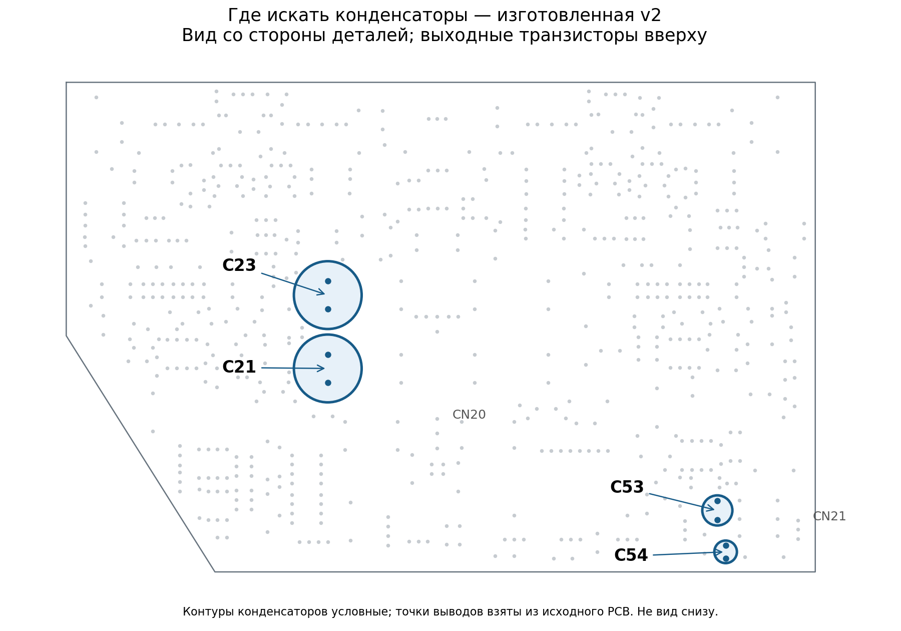
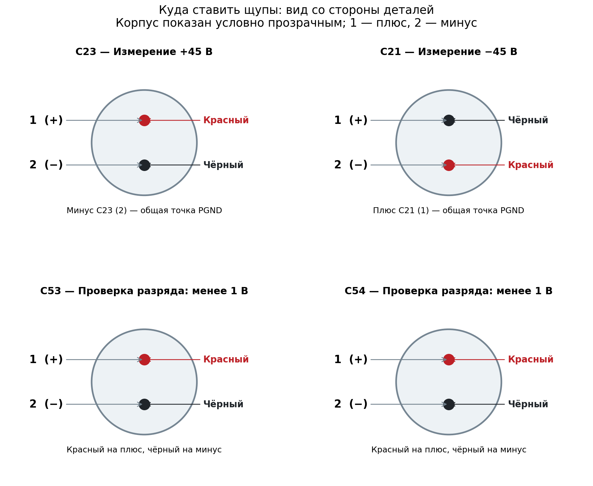

# Первое включение и настройка — Cambridge 640A, собранная v2

**Колонки и сигнал отключены. Громкость — минимум. Радиаторы установлены.**

**Перед работой:** отключить вилку от сети. Мультиметр — DC V; измерить напряжение между двумя выводами каждого из C21, C23, C53, C54. Дождаться **менее 1 В на каждом**. Не замыкать выводы для разряда.

Далее «выключить и проверить разряд» означает именно эту процедуру. Щупы переставлять только после неё. Чёрный провод мультиметра — в COM, красный — в V/Ω; гнёзда A/mA не использовать.

Обозначение **U9.3** означает «вывод 3 U9». У U8/U9/U10 в обычном TO-220 при взгляде на маркировку корпуса, выводами вниз: **1–2–3 слева направо**. У U6 в DIP-8 при взгляде сверху, вырезом вверх: слева сверху вниз **1–2–3–4**, справа снизу вверх **5–6–7–8**. TP1–TP6 — подписанные контрольные площадки платы.

## Где находятся конденсаторы и их выводы

**Оба рисунка — вид со стороны деталей, выходными транзисторами вверх.** Корпуса условно прозрачные: точки — выводы у платы, а не металлическая крышка. Щуп касается вывода или его паяной площадки, **не крышки конденсатора**. При взгляде снизу расположение платы зеркальное.

На C23 чёрный щуп подключается к **нижнему выводу 2 (−)**. На C21 при измерении −45 В чёрный щуп — к **верхнему выводу 1 (+)**, красный — к нижнему 2 (−). Для проверки разряда сравнивать модуль напряжения с 1 В.

## 1. До включения

| Проверить | Норма |
|---|---|
| U6.2 ↔ U9.3, режим Ом | Нет прямого короткого соединения около 0 Ом |
| U6.7 ↔ U9.3, режим Ом | Прямое соединение, около 0 Ом |
| CN20, контакты 1 / 2 / 3 | Жёлтый / красный / **оранжевый — средняя точка** |
| CN21, контакты 1 / 2 / 3 | Зелёный / **фиолетовый — средняя точка** / серый |
| C13/C47 | Неполярные 10 мкФ |
| C22/C42 | Установлены, выводы изолированы |
| C16/C44/C81 | Не установлены; площадки C81 не касаются радиатора |
| U8/U9/U10 на изготовленной плате | Изолирующие прокладки и крепёж; термопаста |
| SAP15 | Установлены на радиатор с предусмотренной изоляцией |
| Остальной монтаж | Полярности верны; нет замыканий, обрезков и оголённых сращиваний |

**Есть несоответствие — не включать; сначала устранить его.**

### Обязательно: установить R116 и R68 перед первым включением

**Вилка вынута, конденсаторы разряжены. Мультиметр — Ом.**

1. Коснуться щупами **двух выводов R120** — по одному щупу на каждый конец резистора. Цвет щупов не важен.
2. **Вращать винт R116**, наблюдая сопротивление. Установить **минимальное показание, близкое к 0 Ом**. Не выбирать направление по часовой стрелке наугад: ориентироваться по уменьшению показания.
3. Перенести щупы на **два вывода R121**. **Вращать R68** до такого же минимума около 0 Ом.
4. Снять щупы. **R116 и R68 теперь установлены в начальное положение. До раздела 4 их больше не вращать.**

R120 подключён параллельно регулируемому участку R116, R121 — R68. Так не нужно угадывать нумерацию ножек подстроечника. Если сопротивление не меняется или минимум не близок к 0 Ом — не включать, проверить монтаж.

## 2. Первое включение через лампу

**R116/R68 уже установлены в минимум сопротивления в разделе 1. Сейчас их не вращать.**

1. Без питания: режим **DC V**, красный щуп — **плюс C23 (вывод 1)**; чёрный — **минус C23 (вывод 2)**.
2. Включить через закрытый ограничитель с лампой **накаливания 100–150 Вт, 230 В**.
3. Норма: лампа вспыхнула и заметно потускнела; на C23 появилось положительное напряжение. Записать его. Выключить и проверить разряд.
4. Выполнить остальные строки таблицы ниже. Для каждой: **закрепить щупы без питания → включить через лампу → измерить → выключить и проверить разряд**.

| Измеряем | Режим | Красный щуп | Чёрный щуп | Проверка через лампу |
|---|---|---|---|---|
| + питание, уже измерено | DC V | C23, плюс (1) | C23, минус (2) | Положительное; ориентир без лампы +45 В |
| − питание | DC V | C21, минус (2) | C21, плюс (1) | Отрицательное; ориентир без лампы −45 В |
| +15 В | DC V | U9.3 | U9.2 | Положительное, около +15 В* |
| −15 В | DC V | U10.3 | U10.1 | Отрицательное, около −15 В* |
| +5 В | DC V | U8.3 | U8.2 | Положительное, около +5 В* |
| DC слева | DC V, затем mV | TP2 | C23, минус (2) | Менее 50 мВ по модулю |
| DC справа | DC V, затем mV | TP5 | C23, минус (2) | Менее 50 мВ по модулю |
| R100, ток покоя | DC mV | TP1 | TP2 | Менее 25 мВ; не растёт быстро само |
| R22, ток покоя | DC mV | TP2 | TP3 | Менее 25 мВ; не растёт быстро само |
| R69, ток покоя | DC mV | TP4 | TP5 | Менее 25 мВ; не растёт быстро само |
| R52, ток покоя | DC mV | TP5 | TP6 | Менее 25 мВ; не растёт быстро само |

*Лампа может понизить питание. Точного общего допуска для этого режима нет. При заметно заниженных выходах стабилизаторов сначала выяснить причину, а не автоматически убирать лампу.*

**Сразу выключить:** лампа постоянно яркая; дым, запах, быстрый нагрев; DC выхода ≥0,5 В; любое падение тока покоя ≥25 мВ или быстро растёт само. Знак показания тока покоя не важен — сравнивать модуль.

Если таблица проверена и отклонений нет: **выключить, проверить разряд, убрать лампу**. Рабочий ток покоя через лампу не выставлять. Лампа не изолирует от сети.

## 3. Включение без лампы: измерение → норма

Без питания закрепить щупы → **включить без лампы** → записать показание → выключить и проверить разряд → переставить щупы. Колонки и сигнал пока отключены.

### Питания и постоянное напряжение выхода

| Измеряем | Режим | Красный щуп | Чёрный щуп | Норма без лампы |
|---|---|---|---|---|
| Основное + питание | DC V | C23, плюс (1) | C23, минус (2) | Около **+45 В** |
| Основное − питание | DC V | C21, минус (2) | C21, плюс (1) | Около **−45 В** |
| +15 В | DC V | U9.3 | U9.2 | Около **+15 В** |
| −15 В | DC V | U10.3 | U10.1 | Около **−15 В** |
| +5 В | DC V | U8.3 | U8.2 | **4,75–5,25 В** |
| DC левого выхода | DC V, затем mV | TP2 | C23, минус (2) | **Менее 50 мВ** по модулю |
| DC правого выхода | DC V, затем mV | TP5 | C23, минус (2) | **Менее 50 мВ** по модулю |

**Питания неверные или DC выхода ≥50 мВ — настройку не начинать, искать причину. R116/R68 напряжения питания не регулируют.**

C53/C54: рабочая норма в мануале не задана; в основной список измерений не включены.

### Ток покоя: проверить сразу, до прогрева

Режим **DC mV**. Чёрный щуп здесь **не на землю**, а на указанную TP.

| Канал | Красный щуп | Чёрный щуп | Регулятор | Цель после настройки |
|---|---|---|---|---|
| Левый, R100 | **TP1** | **TP2** | **R116** | **14–16 мВ** |
| Левый, R22 | **TP2** | **TP3** | **Тот же R116** | **14–16 мВ** |
| Правый, R69 | **TP4** | **TP5** | **R68** | **14–16 мВ** |
| Правый, R52 | **TP5** | **TP6** | **Тот же R68** | **14–16 мВ** |

До регулировки показания могут быть ниже цели. **25 мВ и выше или быстрый самостоятельный рост — выключить.** Не измерять TP1–TP3 вместо двух отдельных пар; аналогично TP4–TP6.

## 4. Настройка тока покоя

**Питание без лампы. Колонки и сигнал отключены. Мультиметр — DC mV. Цель — 15 мВ; допустимый рабочий ориентир — 14–16 мВ на каждой паре.**

### Левый канал: регулируем только R116

1. **Выключить и проверить разряд.** Закрепить **красный щуп на TP1, чёрный на TP2**. Включить. Записать показание R100.
2. **Выключить и проверить разряд.** Закрепить **красный щуп на TP2, чёрный на TP3**. Включить. Записать показание R22. Теперь известны обе величины до регулировки.
3. Решить, нужно ли вращать R116:

| Два показания | Действие |
|---|---|
| Оба в 14–16 мВ | Ничего не вращать; перейти к правому каналу |
| Есть ниже 14 мВ, второе ниже 16 мВ | Один малый шаг R116 в сторону увеличения показания |
| Есть выше 16 мВ, второе выше 14 мВ | Один малый шаг R116 в сторону уменьшения показания |
| Одно ниже 14, второе уже 16 или выше; либо одно выше 16, второе уже 14 или ниже | Выключить: обе половины не укладываются в выбранный диапазон, искать причину |
| Любое ≥25 мВ или быстро растёт само | Сразу выключить |

4. Вращать **R116 изолированной отвёрткой при включённом усилителе и закреплённых щупах TP2–TP3**. Сделать минимальный поворот, наблюдая направление изменения. Один шаг — изменение не более **1 мВ**. Затем **30 секунд не вращать**. Если показание растёт само, больше не увеличивать.
5. После каждого шага снова проверить **обе пары**: красный **TP1**, чёрный **TP2**; затем красный **TP2**, чёрный **TP3**. **Перед каждым переносом щупов выключать и проверять разряд.** Применить таблицу решений ещё раз. Оба значения 14–16 мВ — прекратить регулировку R116.

### Правый канал: регулируем только R68

1. **Выключить и проверить разряд.** Красный щуп — **TP4**, чёрный — **TP5**. Включить, записать падение на R69.
2. **Выключить и проверить разряд.** Красный щуп — **TP5**, чёрный — **TP6**. Включить, записать падение на R52.
3. Выбрать действие для **R68**:
   - Оба показания **14–16 мВ** — не вращать, перейти к прогреву.
   - Есть ниже **14 мВ**, второе ниже **16 мВ** — один шаг в сторону увеличения.
   - Есть выше **16 мВ**, второе выше **14 мВ** — один шаг в сторону уменьшения.
   - Одно ниже **14 мВ**, второе уже **16 мВ или выше**, либо одно выше **16 мВ**, второе уже **14 мВ или ниже** — выключить, искать причину разбаланса.
   - Любое **≥25 мВ** или быстро растёт само — сразу выключить.
4. Если нужна коррекция: при включённом усилителе и закреплённых щупах **TP5–TP6** повернуть **R68** на один малый шаг — не более **1 мВ** изменения, затем наблюдать **30 секунд** без вращения.
5. После каждого шага проверить обе пары: красный **TP4**, чёрный **TP5**; затем красный **TP5**, чёрный **TP6**. Перед переносом щупов выключать и проверять разряд. Оба значения **14–16 мВ — прекратить регулировку R68**.

### Прогрев и окончательная проверка

1. Оставить усилитель без сигнала на **20 минут под наблюдением**, контролируя ток покоя. Не оставлять его без присмотра.
2. Проверить все четыре строки ниже. Перед каждым переносом щупов выключить и проверить разряд; после включения дать показанию вернуться к прогретому уровню. С двумя приборами можно наблюдать обе половины канала одновременно, установив зажимы без питания.

| Проверка после прогрева | Режим | Красный щуп | Чёрный щуп | Норма |
|---|---|---|---|---|
| R100 | DC mV | TP1 | TP2 | 14–16 мВ |
| R22 | DC mV | TP2 | TP3 | 14–16 мВ |
| R69 | DC mV | TP4 | TP5 | 14–16 мВ |
| R52 | DC mV | TP5 | TP6 | 14–16 мВ |
| DC левого выхода | DC mV | TP2 | C23, минус (2) | Менее 50 мВ по модулю |
| DC правого выхода | DC mV | TP5 | C23, минус (2) | Менее 50 мВ по модулю |

3. **Готово:** каждая пара тока покоя остаётся в **14–16 мВ 5 минут без вращения**, изменение за эти 5 минут — не более **1 мВ**; оба DC выхода менее 50 мВ. Если нужна коррекция, повторить действия для соответствующего канала выше и заново проверить обе его половины.

**14/16 мВ — оставить. 12/18 мВ — выключить и искать причину, а не увеличивать ток.** Быстрый самостоятельный рост или 25 мВ — немедленное выключение.

## 5. Перед подключением колонок

| Проверка | Норма / действие |
|---|---|
| Реле защиты | Выходные контакты замкнулись; защиту не обходить |
| DC на акустических клеммах | Красный щуп на красную клемму, чёрный на чёрную; **менее 50 мВ** на каждом канале |
| Эквивалент нагрузки | **8 Ом / не менее 50 Вт**, подключить без питания |
| Синус 1 кГц, малый уровень | На осциллографе чистая форма, без клиппинга и ВЧ-возбуждения; проверить и без сигнала |
| После теста без сигнала, DC mV | Красный/чёрный: **TP1/TP2, TP2/TP3, TP4/TP5, TP5/TP6 — 14–16 мВ**. Затем **TP2/минус C23, TP5/минус C23 — менее 50 мВ** |

Общий зажим сетевого осциллографа — на **минус C23 (вывод 2, PGND)**. Наконечник щупа — на красную акустическую клемму проверяемого канала; зажимы установить без питания. Не отключать его защитное заземление. Без осциллографа отсутствие возбуждения не подтверждено. После успешных проверок **выключить**, подключить колонки, начать с минимальной громкости.

## Записать результаты

| Параметр | Через лампу | Без лампы | После прогрева |
|---|---|---|---|
| +45 / −45 В | | | |
| +15 / −15 / +5 В | | | |
| DC слева / справа, мВ | | | |
| TP1–TP2 / TP2–TP3, мВ | | | |
| TP4–TP5 / TP5–TP6, мВ | | | |

**Основание:** [мануал, Amplifier Bias Setup, стр. 4](../Cambridge_Azur_640A_V1_Service_Manual_AP14676-1.pdf) требует **>13 мВ** на каждом резисторе. Диапазон 14–16 мВ, границы DC, порог остановки 25 мВ и интервалы проверки — практические ориентиры этой инструкции, не заводские допуски. Пары щупов сверены со схемой; реальная плата ещё требует проверки.
