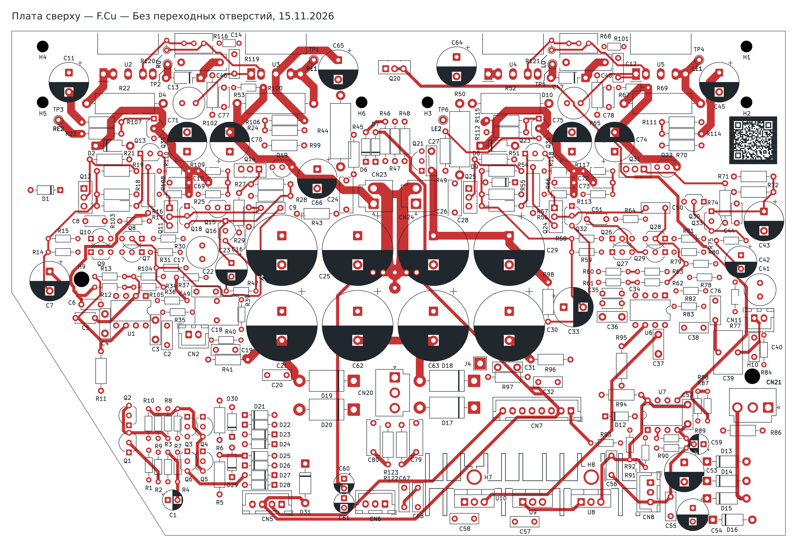
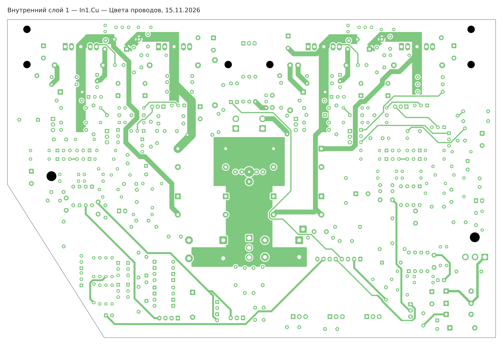
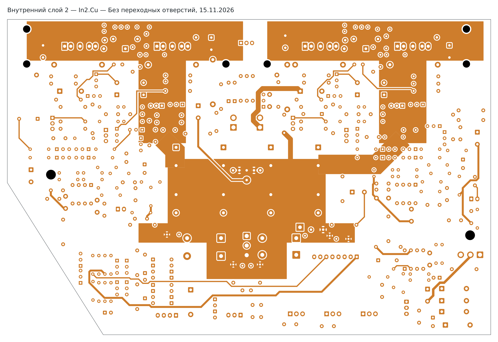
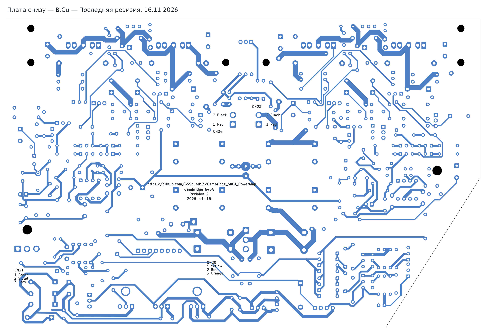

# Послойная разводка и отличия от заводской платы Cambridge 640A

Опубликовано 16.11.2026. Здесь показаны **актуальные исходники следующего изготовления**. Уже изготовленная v2 и её Gerber имеют другую разводку. Сравнение ниже — с заводской Cambridge AP12708/6a из сервис-мануала, не с промежуточными версиями нашего проекта.

[Все четыре слоя одним PDF](layer-plans/all_four_layers.pdf) · [Планы с комментариями, PDF](layer-plans/routing_commentary.pdf) · [Проект KiCad](no-vias/Cambridge_640A_no_vias.zip)

## 1. Верхний слой — F.Cu

[Открыть PDF](layer-plans/top.pdf) · [Векторный SVG](layer-plans/top.svg)

Вид со стороны деталей. Здесь проходят локальные соединения каскадов, часть выходных и силовых цепей. Надписи помогают сопоставить дорожки со схемой и деталями.

Принцип: у одинаковых узлов каналов сохранять одинаковую геометрию, не делать длинных обходов ради удобства автоматического трассировщика. Сигнальные дорожки и силовые соединения имеют разную ширину. Расстановка и трассировка рассматриваются вместе: короткое соединение полезнее, если при этом остаётся понятным путь обратного тока.

## 2. Первый внутренний слой — In1.Cu

[Открыть PDF](layer-plans/inner1.pdf) · [Векторный SVG](layer-plans/inner1.svg)

Основная задача — распределение **+45 В и −45 В** полигонами. На этом же слое проходят отдельные соединительные дорожки; это не сплошной слой питания без разрывов.

Принцип: подводить питание широкими участками меди и сохранять электрическую связность всех частей заливки. В текущей плате подводы +45 В от банка конденсаторов к U3/U5 имеют ширину **3,5 мм и 2 мм**. Они различаются из-за положения общего банка и окружающих цепей. Это общие подводы питания, а не парные локальные сигнальные маршруты.

По сравнению с заводской односторонней разводкой часть питания перенесена с дорожек и проводов на внутреннюю медь. Это даёт больше свободы для распределения токов и уменьшения общих узких участков. Численного выигрыша по сопротивлению и падению напряжения относительно оригинала для этой версии не измеряли.

## 3. Второй внутренний слой — In2.Cu

[Открыть PDF](layer-plans/inner2.pdf) · [Векторный SVG](layer-plans/inner2.svg)

Основная задача — **силовая земля PGND**: возвраты выпрямителя, накопительных конденсаторов, выходных каскадов и акустики. Заполненная PGND в текущем проекте образует одну связанную область. Отдельные дорожки присутствуют и на этом слое; вырезы вокруг них видны на плане.

Принцип: силовые токи не должны использовать случайные участки сигнальной земли как свой возврат. Цепи **PGND, GND, digital и AUX0V** разделены по назначению и соединены через **NT1–NT3** возле общей точки банка конденсаторов.

Звезда земли не является новым изобретением этого проекта: в оригинале также есть организация возвратов проводами. Здесь её реализация перенесена в геометрию платы. Это делает соединения воспроизводимыми и уменьшает зависимость от прокладки отдельных проводов. Снижение фона и взаимного влияния каналов пока не подтверждено измерениями.

## 4. Нижний слой — B.Cu

[Открыть PDF](layer-plans/bottom.pdf) · [Векторный SVG](layer-plans/bottom.svg)

**Вид снизу, зеркальный относительно верхних планов.** Здесь находится значительная часть межкомпонентных соединений, в том числе сигнальные, выходные и вспомогательные цепи. Нижняя шелкография содержит обозначения цветов проводов у разъёмов.

Принцип: использовать нижнюю медь совместно с остальными слоями, чтобы обходы не превращались в длинные «лестницы». Переключение между слоями выполняется через существующие металлизированные площадки выводных деталей. **Отдельных переходных отверстий в текущем проекте нет.** Это свойство новой платы, а не доказательство преимущества перед заводской односторонней платой.

## Общие правила разводки

- **Соответствующие узлы каналов разводятся одинаково.** Проверены 33 пары компонентов и 50 парных соединений: форма, слой и ширина согласованы. Это не означает, что вся плата зеркальна: питание, защита и внешние подключения имеют общую и местами различную геометрию.
- **Ширина зависит от назначения цепи.** Приняты минимумы: обычный сигнал 0,5 мм; класс Supply 0,8 мм; вспомогательная обмотка 1 мм; силовые, выходные и основные трансформаторные цепи 2 мм. В нужных местах ширина увеличена. Это правила дорожек, а не гарантированный допустимый ток всего пути через площадки и тепловые спицы.
- **Короткие пути без лишних изгибов.** Важные участки проверены и переработаны вручную после автоматической трассировки. У новых сегментов прямые направления и углы 45°; отсутствие переходов не должно достигаться ценой чрезмерного обхода.
- **Проверяется весь путь тока.** Учитываются не только прямая дорожка, но и возврат, связь полигонов, сужения у площадок и общая точка земель.
- **Четыре слоя проверяются вместе.** DRC без активных нарушений и несоединений; соответствие схеме проверено. Сохраняются 73 ранее принятых исключения courtyard. Проверка файлов не заменяет испытание усилителя.

## Что получено относительно заводской платы

**Меньше ручных соединений.** В оригинале применены проволочные перемычки LK — в BOM основной платы указано 19 штук — и соединения WIRE LINK. В новой плате эти связи выполнены медью. Результат: меньше операций пайки перемычек и меньше зависимости от их ручной прокладки.

**Более удобное снятие платы.** В оригинале провода трансформатора и выходов припаяны к клеммам. В текущем проекте используются разъёмы JST VH: CN20/CN21 для вторичных обмоток, CN23/CN24 для выходов. На шелкографии указаны номера контактов и цвета проводов. Соединения можно разъединить без выпаивания проводов.

**Питание и возвраты перенесены на внутренние слои.** Вместо одной рабочей стороны меди с проводами и перемычками используются четыре слоя. Полигоны питания и PGND позволяют задать их геометрию в проекте. Назначение — уменьшить влияние больших токов на сигнальные цепи; результат по шуму пока предстоит проверить.

**Повторяемость каналов.** Для соответствующих узлов заданы общие правила размещения и одинаковые локальные маршруты. Это упрощает сравнение каналов при проверке и ремонте. Улучшение разделения каналов в децибелах не заявляется без измерений.

**Удобнее настройка.** Добавлены TP1–TP6 для измерений падения на эмиттерных резисторах. В заводском порядке измерения выполняются непосредственно на резисторах. Назначение контрольных точек — удобное подключение прибора; они сами по себе не изменяют работу усилителя.

**Расширены посадочные места электролитов:** C13/C47 и C22/C42 — **Ø8 мм, шаг 3,5 мм**; C70/C71/C74/C75 — **Ø10 мм, шаг 5 мм**. C13/C47 остаются неполярными. Это запас под более крупные корпуса в проекте следующего изготовления; уже изготовленная плата не меняется.

**Цена этих изменений:** четырёхслойная плата сложнее и дороже односторонней; внутреннюю медь нельзя осмотреть или исправить так же просто, как наружную. Разъёмы добавляют контактные соединения. Отсутствие отдельных переходов не отменяет требований к качеству металлизации отверстий компонентов.

## Чего это пока не доказывает

Для оригинала и новой платы не выполнен сопоставимый набор измерений сопротивления шин, фона, искажений, разделения каналов, нагрева и устойчивости. Поэтому здесь нет процентов улучшения, обещаний «лучшего звука» или сравнения длин с промежуточными вариантами проекта. Выигрыш подтверждён в конструкции и удобстве подключения; электрические преимущества остаются целью до испытаний.

Толщина меди **70 мкм снаружи и 35 мкм внутри**, толщина платы **1,6 мм** — параметры задания KiCad, а не результат измерения изготовленной платы. Старые расчётные оценки сопротивлений земли не следует переносить на эту разводку.

## Источники и файлы

- [Сервис-мануал Cambridge Azur 640A V1 AP14676/1](../Cambridge_Azur_640A_V1_Service_Manual_AP14676-1.pdf): заводская схема, монтажный рисунок основной платы и BOM; список 19 LK — печатная стр. 25.
- [Текущая PCB](../../640A_PowerAmp.kicad_pcb), [схема](../../640A_PowerAmp.kicad_sch), [BOM](../../BOM.md).
- [Отчёт проверок текущей разводки](NO_VIAS.md); [расширение посадок](CAPACITOR_FOOTPRINT_PLAN.md).
- [Контрольная сумма PCB и послойных файлов](layer-plans/source.json). Послойные PDF/SVG соответствуют текущей PCB; исходный экспорт выполнен KiCad 10.0.8. PNG встроены из того же проверенного комплекта. Новый производственный комплект Gerber этой публикацией не выпускается.
