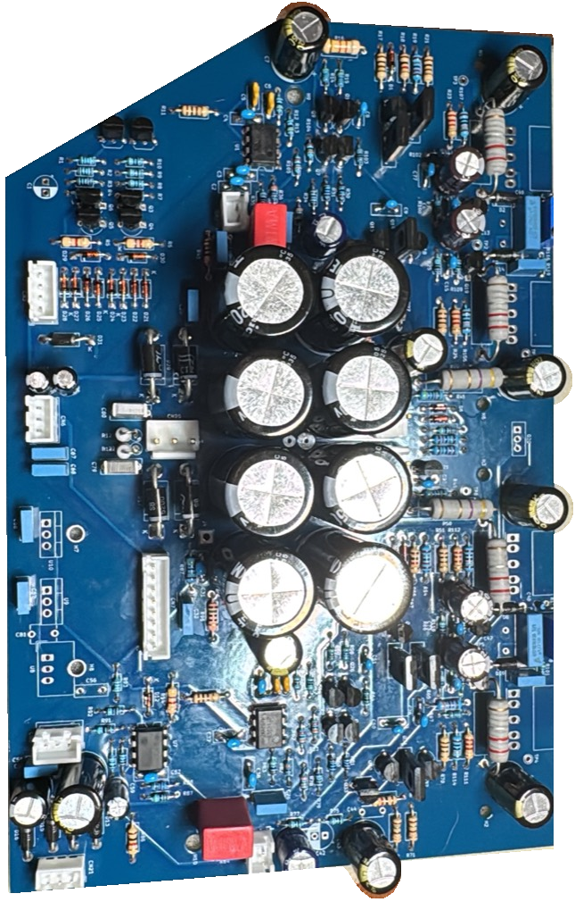

# Сборка основной платы v2 — 13.11.2026

По оценке владельца, сборка готова примерно на **95%**. Рассчитываем
провести первые испытания в течение ближайших двух недель. Это снимок
процесса сборки; работа усилителя ещё не подтверждена измерениями.

Для публикации из предоставленной фотографии удалён окружающий фон; пиксели
платы и установленных компонентов не перерисованы. Геометрия под оставшиеся
конденсаторы C22/C42 приведена в [CAD-наборе](../C22_C42_CAD/README.md).
