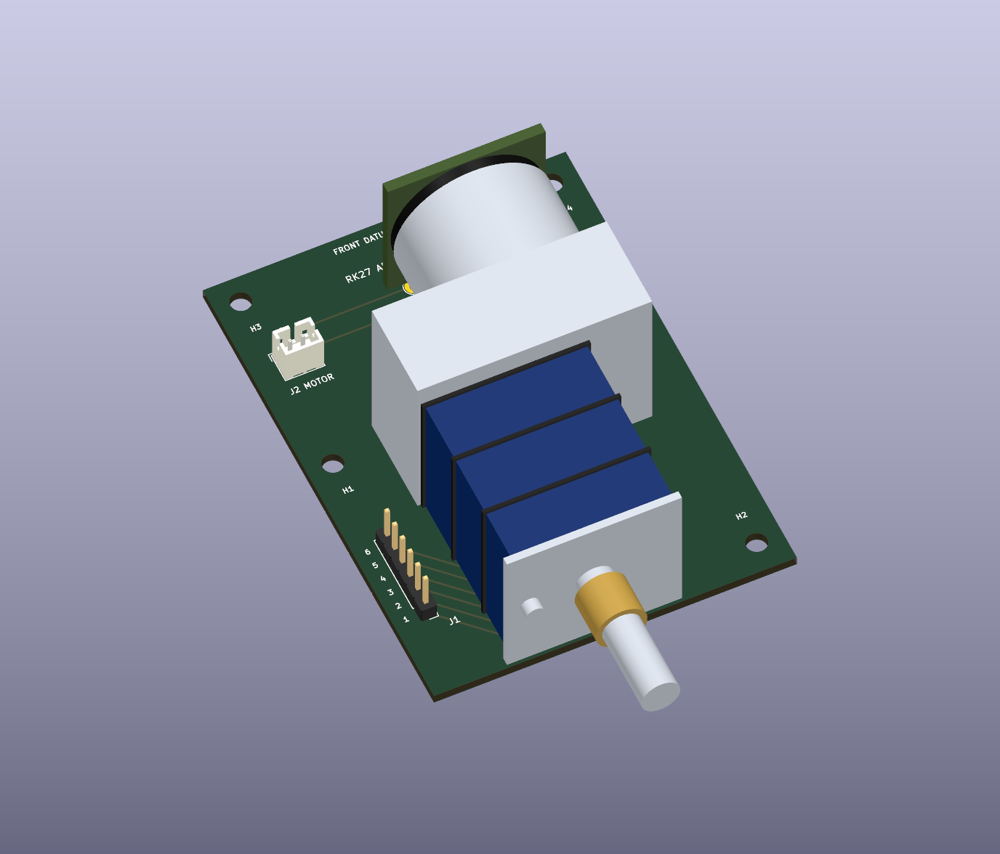

# Переходная плата моторизованного ALPS RK27

**Рабочая ревизия A-draft. Верхняя плата и механическая сборка двух плат подготовлены; электрическая переделка нижней платы не завершена. Не выпуск для изготовления.**

Открыть `alps-rk27-adapter.kicad_pro` в KiCad 10. PCB и схема самостоятельные. Плата двухслойная, 1,6 мм, размер 56 × 76,5 мм. Передний край исправлен по рисунку мануала: отступ переднего ряда 3,5 мм. Центры старых регуляторов сохранены; это восстановление номинальных размеров по изображению, а не размерный заводской чертёж.

## Посадочные места

| Элемент | Источник | Отверстие / площадка |
|---|---|---|
| RV1, аудио 1–6 | SamacSys RK27112MC из архива пользователя LIB_RK27112MC01P.zip | Ø1,2 / Ø1,8 мм; шаг 5 мм, между рядами 10 мм |
| RV1, механические 7–8 | Тот же готовый компонент | Ø2,86 / Ø4,2 мм; электрически не подключены |
| MP1, MP2, печатные выводы двигателя | TestPoint:TestPoint_THTPad_D2.5mm_Drill1.2mm | Ø1,2 / Ø2,5 мм |
| J1 | Connector_PinHeader_2.54mm:PinHeader_1x06_P2.54mm_Vertical | Ø1,0 / 1,7 × 1,7 мм; шаг 2,54 мм |
| J2 | Connector_JST:JST_PH_B2B-PH-K_1x02_P2.00mm_Vertical | Штатная библиотека KiCad, JST PH 2-pin |
| H1–H4 | MountingHole:MountingHole_3.2mm_M3 | Ø3,2 мм, NPTH |

Самодельных посадочных мест в действующей плате нет. Геометрия всех восьми площадок SamacSys сравнена с исходным файлом: размеры, сверловка, форма и центры не изменены. Рисунок корпуса/вала SamacSys перенесён с F.Silkscreen на F.Fab, поскольку он выходит за передний край; добавлена привязка отдельной 3D-модели. Это изменения оформления, не площадок. Полярность двигателя не выдумана: MOTOR_A/B. Пользователь подтвердил отдельные печатные выводы двигателя. Они реализованы MP1/MP2, а НЕ крепёжными площадками 7/8 RV1.

J1 расположен слева при взгляде со стороны вала; ряд идёт в глубину корпуса. Контакт 1 ближе к передней панели. Его порядок: передняя секция LOW/WIPER/HIGH, задняя LOW/WIPER/HIGH. Земли секций не соединены на переходнике.

## Источники и координаты

[ALPS KK-98-4424 / K272AMC02C, листы 5–6](https://asset.conrad.com/media10/add/160267/c1/-/en/000442029DS01/scheda-tecnica-442029-alps-401722-rk27112mc-100kax2-potenziometro-motorizzato-protetto-dalla-polvere-stereo-005-w-100-k-1-pz.pdf) и [каталог ALPS, стр.44, рисунок 6](https://www.meditronik.com.pl/doc/plusik/rk27112mc.pdf). Обозначения концов: 1 CCW, 2 движок, 3 CW. [Карточка готового места SamacSys](https://componentsearchengine.com/part-view/RK27112MC01P/ALPS%20Electric).

X — вправо при взгляде на вал спереди; D — в глубину. D=0 — монтажная плоскость ALPS. PCB: `x=85+X; y=140-D`. Аудиовыводы X=-5/0/5, D=5/15. Моторные MP1/MP2: X=2/19, D=66,2; шаг 17 мм. Крепёжные язычки: X=-7/11,5, D=45,5. Передний край адаптера D=1,5.

Файл SamacSys относится к RK27112MC01P 50k log. Это происхождение библиотеки, а не подтверждение номинала купленного пользователем изделия. Номинал в схеме TBC. Пользователь подтвердил моторные печатные выводы; полный код и профиль вала ещё неизвестны.

## Проекция двух плат

Исправленная нижняя плата: передний край X=60,0; передний ряд VR1 X=63,5, Y=93,7/98,7/103,7. Отступ 3,5 мм. Преобразование: `R3_X=58.5+D; R3_Y=98.7+X`. Передний ряд ALPS совпадает по центрам с VR1 6/5/4. Сетка центров сверена с рисунком мануала; остаётся проверка по реальной плате. Диаметр старых отверстий 1,3 мм, ALPS — 1,2 мм. Это проекция центров; электрический порядок противоположен, поэтому подключение через J1. Задний ряд ALPS на 5 мм глубже старого.

Четыре оси винтов новые, общие для основной и переходной платы. Существующих крепёжных отверстий не предполагаем. Верхние отверстия уже размещены; нижние ещё не внесены:

| Ось | X в координатах R3, мм | Y, мм |
|---|---:|---:|
| H1 | 102,0 | 77,7 |
| H2 | 64,7 | 125,7 |
| H3 | 132,5 | 77,7 |
| H4 | 132,5 | 125,7 |

Нижняя R3 расширена с разрешения пользователя. Все четыре новые оси теперь внутри обеих плат. H1 перенесена вдоль левой кромки: на нижней плате X=102,0, Y=77,7 мм, на верхней X=64,0, Y=96,5 мм. Остальные оси в таблице выше без изменений. [Актуальные координаты](integration/two_board_alignment.json).

[Нижняя плата и пояснения](../volume-control-repair/README.md). Исходник пользователя сохранён отдельно. Толщина нижней ремонтной накладки 0,6 мм сохранена.

Для совместного просмотра открыть integration/two-board-assembly.kicad_pcb в KiCad и вызвать 3D Viewer. Обе платы видны одновременно; верхняя редактируется отдельно, нижняя включена как 3D-модель. Это сборочный файл, НЕ для изготовления. [Общий вид](renders/two-board-assembly.png), [вид сбоку](renders/two-board-side.png). Показаны длинные штыри 14,5 мм и условные полупрозрачные опоры; конкретные винты и втулки ещё не выбраны.

## Высота и штыри

Между верхними поверхностями плат 8–9 мм; для сборочного просмотра принять 8,5 мм. При верхней PCB 1,6 мм чистый зазор 6,4–7,4 мм (номинально 6,9). Четыре винта/опоры должны задавать эту высоту. Длина и тип винтов зависят от реальной нижней платы и опор, пока не выбраны.

Стандартная модель J1 показывает обычную короткую гребёнку, не окончательную длинную линейку для жёсткой пайки. Для двух плат по 1,6 мм и выступов по 1 мм нужна общая длина штыря 11,6–12,6 мм минимум. Для квадратного вывода 0,64 мм диагональ 0,905 мм; отверстие J1 1,0 мм требует проверки допусков фактического штыря и готовой металлизации. Размеры выводов, длину и положение изолятора нельзя выводить только из имени посадочного места.

## 3D

Модель ALPS подключена к RV1 в PCB и видна в KiCad 3D Viewer. Исправлены обращённые внутрь поверхности цилиндров, совпадающие торцы и размещение относительно импортированного места. Оси вала и двигателя параллельны D; Z=12,5 мм. Двигатель смещён вправо на 10,5 мм. Проверка замкнутости/направления поверхностей: [model_geometry.json](validation/model_geometry.json).

Архив SamacSys содержит `3D=N`; готовой 3D-модели в нём нет. Сохранена собственная УПРОЩЁННАЯ модель по габаритам чертежа: условная форма редуктора и задней платы, без точной резьбы и профиля вала. Вал показан 20 мм. Для окончательного ложемента и точного воспроизведения экземпляра нужна точная модель/обмер. [Вид сбоку](renders/right.png), [спереди](renders/front.png), [сверху](renders/top.png), [снизу](renders/bottom.png).

## Проверки и воспроизведение

[DRC](validation/drc.json), [ERC](validation/erc.json), [схема PDF](renders/schematic.pdf), [схема PNG](renders/schematic.png), [разводка](renders/layout.svg). Проверки выполнены KiCad 10.0.6. Их результат не подтверждает пространство в корпусе, соответствие фактическому экземпляру и нижнюю сборку.

`build.py` перезаписывает верхнюю плату и схему; `verify_preview.py` обновляет проверки и виды. Для генерации/библиотечной проверки установить из своего архива файл `RK27112MC.kicad_mod` в `vendor-local/SamacSys.pretty/`. Библиотека не публикуется: лицензия SamacSys разрешает проекты плат, но запрещает распространение библиотечных компонентов вне собственной компании. Готовая PCB содержит встроенное место и открывается без отдельной библиотеки; для её сопоставления с библиотекой нужен локальный файл. Подробности: [THIRD_PARTY.md](THIRD_PARTY.md), [аудит источника](validation/supplier_footprint.json).

## Сверка с сервисным мануалом

В [мануале Cambridge V1](../../doc/Cambridge_Azur_640A_V1_Service_Manual_AP14676-1.pdf) на странице 12 указан PY004, RM16, 20 кОм dual log, выводы 22 мм. Страница 10 содержит заводской рисунок Input & Tone PCB. Размерных надписей сверловки и отступа VR1 на нём нет.

По векторным центрам рисунка, с калибровкой по CN1 (шаг 2,54 мм указан в BOM), получены приблизительно: шаг контактов 5,0 мм; между рядами 5,0 мм; отступ переднего ряда от края 3,5 мм; квадратные медные площадки около 2,54 мм. Это измерения изображения, НЕ заводские размерные допуски. Диаметр сверловки из рисунка не определяем. [Расчёт](integration/manual_comparison.json).

Отступ R3 2,8 мм исправлен на 3,5 мм: нижняя передняя кромка X=60,0; верхняя D=1,5 мм. Координаты отверстий VR1/VR4 и расстояние 48,7 мм между их осями сохранены: они согласуются с номинальной сеткой рисунка мануала.

Не следует делать все отверстия одинаковыми: у ALPS между аудиорядами 10 мм, у прежнего RM16 около 5 мм; геометрия площадок SamacSys отличается от старой платы. Сохраняем ALPS по его чертежу и готовому месту, совмещаем передний ряд по восстановленным номинальным координатам. Четыре винтовые оси проектируются отдельно и должны совпасть на двух платах.

Совпадение всех четырёх винтовых осей, шести штырей, трёх передних аудиовыводов и передних кромок проверено по сохранённым PCB: [integration.json](validation/integration.json). `integrate.py` обновляет нижнюю плату и сборку; `verify_integration.py` проверяет проекции.
