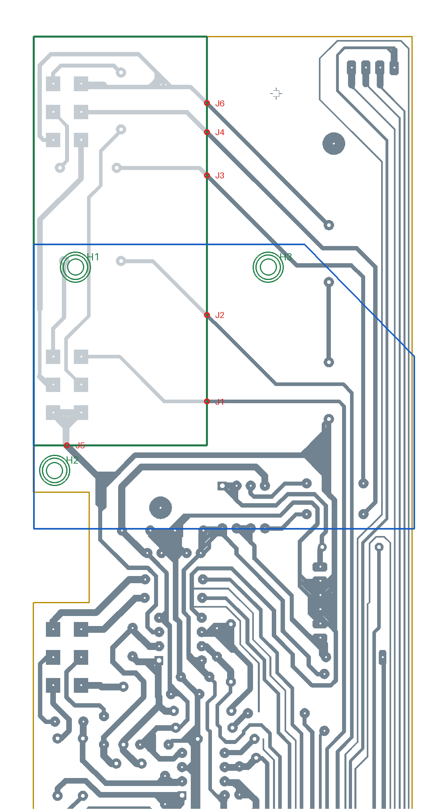
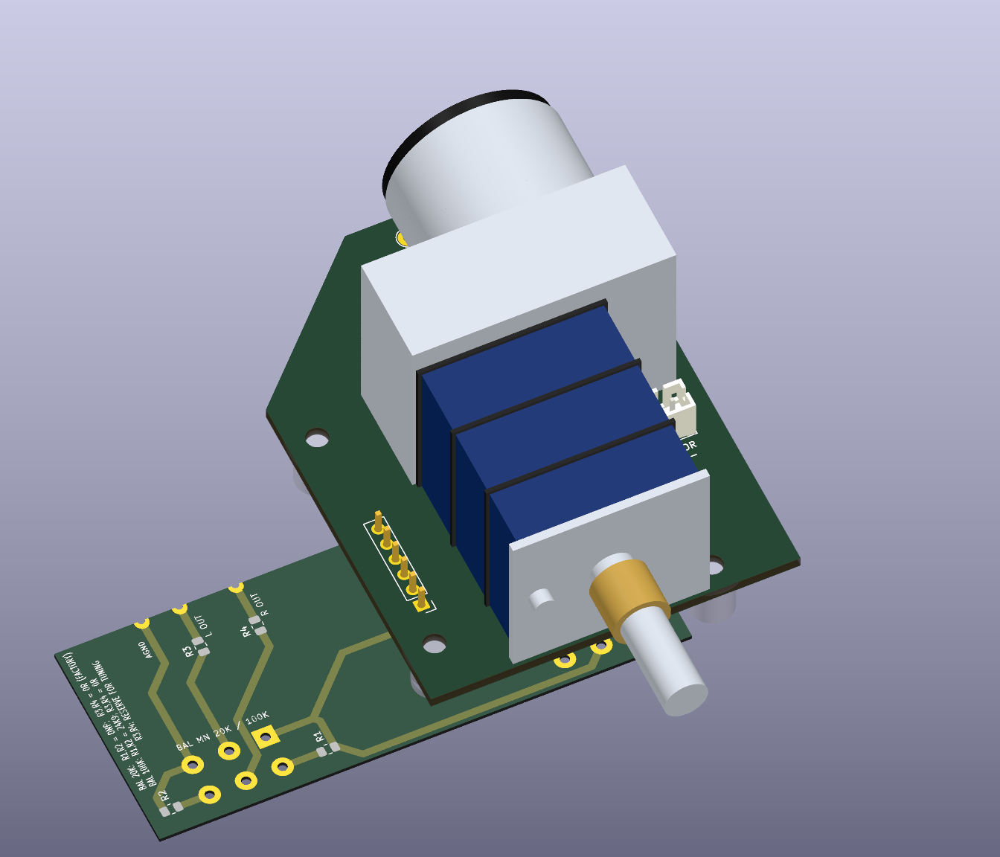

# Регулятор громкости — единый проект KiCad 10

Откройте **VolumeControl.kicad_pro**. Переносите всю папку вместе с `models/`; отдельный PCB из Downloads теряет относительные ссылки на модели.

| Файл | Назначение |
|---|---|
| VolumeControl.kicad_pcb | Основной вид сборки двух плат, ALPS, штырей и габаритов опор. Только визуализация сборки, не файл для изготовления |
| VolumeControl.kicad_sch | Электрическая схема переходника ALPS |
| ALPS_Adapter.kicad_pcb | Редактируемая верхняя плата, 1,6 мм |
| Repair_Reference.kicad_pcb | Редактируемая нижняя плата со справочными заводскими дорожками и проекцией переходника |

KiCad связывает проект с одним основным PCB. Две редактируемые платы находятся в этой же папке; открывайте их через «Файл → Открыть» в PCB Editor. В основной сборке нижняя плата представлена 3D-моделью. В 2D файлы VolumeControl и ALPS_Adapter похожи: первый содержит ту же верхнюю плату, а нижняя добавлена в него только как 3D-модель. Общую сборку смотрите через Alt+3. Изменения отдельных плат не обновляют сборку автоматически; sync_mechanical.py обновляет сборку по текущим платам, не меняя их разводку и геометрию. Схема описывает только переходник; электрическая схема ремонтной платы ещё не разработана.

## Обновление общего 3D-вида после правок

1. Сохраните изменения в `Repair_Reference.kicad_pcb` и/или `ALPS_Adapter.kicad_pcb`.
2. Закройте окно редактора общей сборки `VolumeControl.kicad_pcb`, чтобы не перезаписать результат старой открытой копией.
3. Запустите двойным щелчком `Update_Assembly.cmd` в этой папке и дождитесь сообщения `Assembly updated`.
4. Заново откройте `VolumeControl.kicad_pcb`, затем 3D-просмотр через Alt+3.

Обновление пересоздаёт общий PCB и модель нижней платы из сохранённых файлов; исходные редактируемые платы не меняет. Несохранённые изменения редактора в сборку не попадут. Изображения в `renders/` — отдельные снимки, команда их не обновляет. Габариты опор берутся из `reference/three-supports.json`: при переносе креплений требуется отдельно согласовать этот файл и обе платы.

## Согласование механики

23 ноября пользователь завершил ручную разводку обеих плат. По его указанию на адаптере обменены слои F.Cu/B.Cu, без изменения координат, ширин и цепей. Нижняя разводка сохранена без изменений. См. [комплектацию и пояснения](ASSEMBLY_NOTES.md). Ремонтная плата уменьшена до **31 × 73 мм**: X=60…91, Y=36,5…109,5 мм. Торец проходит между площадками громкости и H2. Заводской вырез находится за пределами этой небольшой платы, поэтому её контур прямоугольный. H1 проходит через ремонтную и основную платы; H2 и H3 сверлятся только в основной плате. На ремонтной плате последние две оси показаны справочной проекцией.

Три отверстия Ø3 мм без металлизации, стандартные из KiCad, под измеренные шурупы Ø2,7 мм с головкой Ø4,5 мм: H4 удалена, H2 перенесена пользователем в (63,75;114). Адаптер — 50,7 × 68,2 мм по габариту, с диагональным срезом дальнего левого угла; задний край на 3 мм за двигателем текущей габаритной модели, правый край на 3 мм правее редуктора. J2 перенесён к H2, перед редуктором, в (103;113) мм. Надпись RK27 удалена. Верх адаптера расположен на 8,5 мм выше верха основной платы: чистый зазор над основной платой 6,9 мм, над ремонтной платой толщиной 0,6 мм — 6,3 мм, без учёта клея. В 3D представлены адаптер и ремонтная плата; заводская основная плата не моделируется. Две опоры заканчиваются на её условной верхней плоскости.

В `Repair_Reference.kicad_pcb`:

- **User.1** — ограниченный векторный рисунок нижней меди из мануала, страница 11: X=55…133,2 мм, Y=31,5…174,4 мм. Снизу оставлено 50 мм от нижнего края наших контуров, сверху и по бокам — 5 мм контекста. Это справочная графика, а не электрическая разводка.
- **User.2** — номера площадок регуляторов и замечания к отверстиям.
- **User.3** — контур верхней платы, проекция сверловки Ø3 мм, головки Ø4,5 мм и зоны без меди Ø5,5 мм.
- **User.4** — заводской контур из мануала, обрезанный до той же области.
- **Edge.Cuts** — текущий контур ремонтной платы.

Для просмотра наложения включите User.1–User.4 и Edge.Cuts; рабочие слои меди можно временно скрыть. Вид соответствует общим координатам PCB, а не зеркальному виду при переворачивании физической платы.

Серый — заводская медь, зелёный — ремонтная плата, синий — переходник, жёлтый — заводской край.

**Под ремонтной платой пользователь полностью удаляет заводскую медь шлифованием.** На рисунке эта область осветлена. Пересечения отверстий со старой медью внутри неё не являются конфликтом; рабочие дорожки ремонтной платы остаются и проверены отдельно.

| Ось | Координаты нижней платы, мм | Проверка |
|---|---|---|
| H1 | 67,5;77,7 | Поднята на 2,8 мм к шестипиновому разъёму; заводская медь под ремонтной платой удаляется |
| H2 | 63,75;114 | Перенесена пользователем; теперь над материалом заводской платы, вне выреза |
| H3 | 102;77,7 | Прежняя точка |

Три оси и шесть межплатных контактов совпадают. На адаптере 24 пользовательских сегмента шириной 1 мм: после переноса 23 находятся на B.Cu и один на F.Cu. На ремонтной плате 62 сегмента; один пользовательский участок шириной 0,2 мм сохранён без исправления.

Текущие проверки — `validation/user-*-drc.json`: незавершённых соединений нет на обеих платах, ошибок геометрии/зазоров не обнаружено. Предупреждения библиотек и оформления остаются; на ремонтной плате есть предупреждение о висящем конце дорожки. Отчёты `routed-*` и `routing-attempt.json` относятся к предыдущей пробной разводке. Точная сохранность ручных дорожек проверяется по `reference/user-routing-transfer.json`.

Перед изготовлением пользователь должен измерить имеющиеся SMD-резисторы и сверить посадку прибывшего ALPS, включая выводы двигателя. Полная электрическая схема ремонтной платы пока не оформлена; успешный PCB DRC её не заменяет.

## Краевые точки пайки к заводской плате

| Контакт | X; Y, мм | Назначение |
|---|---|---|
| J1 | 91; 101,704940 | Правый вход |
| J2 | 91; 86,236944 | Левый вход |
| J3 | 91; 61,315669 | Правый выход |
| J4 | 91; 53,606969 | Левый выход |
| J5 | 65,998582; 109,5 | Земля участка громкости |
| J6 | 91; 48,411463 | Земля участка баланса |

Центры выставлены на серединах пересечений контура с заводской медью из мануала. Два сигнальных пути дополнительно проверены через заводские перемычки верхней стороны. Для двух участков земли нужны отдельные точки J5 и J6. Отчёт: `reference/edge-solder-alignment.json`; шаблон: `renders/solder-template-1to1.svg` (печатать 100%, проверить линейку 10 мм). Число знаков в координатах отражает расчёт, а не точность физического изделия: до сверления обязательна примерка шаблона к реальной плате.

[Правила разводки](ROUTING_RULES.md) сохранены как ориентир. Ручная разводка пользователя имеет приоритет: автоматическая переразводка не запускалась.

Размеры крепежа уточнены: головка Ø4,5 мм, стержень Ø2,7 мм, отверстие PCB Ø3 мм, отступ меди от головки 0,5 мм. Габариты полупрозрачных опор в 3D условные; ложемент и шурупы ещё не моделируются точно.

Отчёт `reference/factory-audit.json` сохраняет сравнение со старой медью, `reference/three-supports.json` — актуальную механику. Справочные слои не участвуют в электрическом DRC.

Масштаб и положение рисунка подогнаны по 12 центрам площадок VR1/VR4. Максимальная невязка 0,0232 мм — только согласованность иллюстрации и выбранной сетки, не точность реальной платы. Мануал не является размерным сверловочным чертежом. Диаметры старых отверстий не выведены из рисунка. Имена неизвестных цепей не угаданы.

## 3D и библиотеки

ALPS отображается из `models/ALPS_RK27112MC_envelope.wrl`. Это упрощённая габаритная модель, не точная модель производителя. Оси двигателя и вала параллельны; двигатель смещён вбок по чертежу. Ошибочная большая вертикальная плата за двигателем удалена по замечанию пользователя; оставлены задняя крышка двигателя и два печатных вывода. Модель не заменяет сверку полного артикула, профиля вала и фактического экземпляра.

Посадочное место ALPS встроено в PCB из предоставленной библиотеки SamacSys; стандартные разъёмы и отверстия — из KiCad. Отдельная библиотека SamacSys не публикуется согласно условиям её архива. Для открытия готовой платы она не нужна. См. `THIRD_PARTY.md`.

Проверки и ограничения предыдущей электрической ревизии сохранены в `validation/`: верхняя плата ранее проходила DRC/ERC; нижняя содержит незавершённые соединения. Новый проект не является комплектом производственных файлов. Исходная R3 сохранена как справочный файл без отдельного проекта в `reference/`. Подробности выбора геометрии — в `documentation/` (исторические имена файлов в этих документах относятся к прежним ревизиям).

H1 на адаптере остаётся в (64;131) мм. Разъём J1 не перемещался. Старый расчёт `reference/H1-routing-corridor.json` для консервативного диаметра Ø7 мм сохранён как исторический; текущая головка Ø4,5 мм меньше.

Варианты баланса и назначение R3/R4 приведены в [ASSEMBLY_NOTES.md](ASSEMBLY_NOTES.md) и подписаны на ремонтной плате. R3/R4 по умолчанию 0 Ом; площадки оставлены как резерв для возможного подбора последовательного сопротивления, без заранее рассчитанной компенсации.
